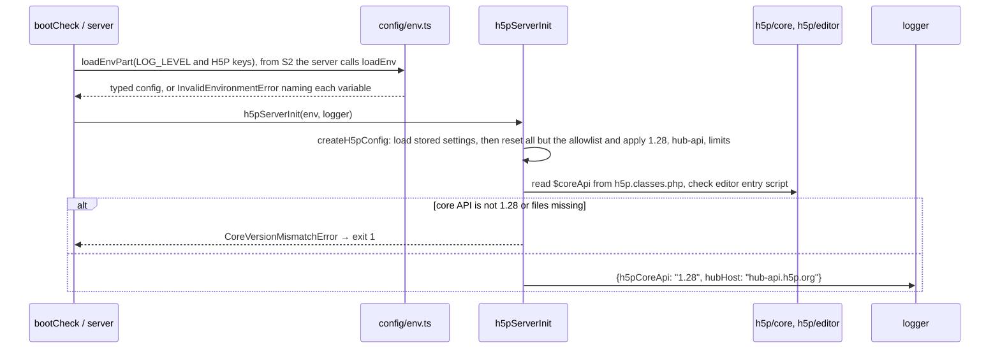
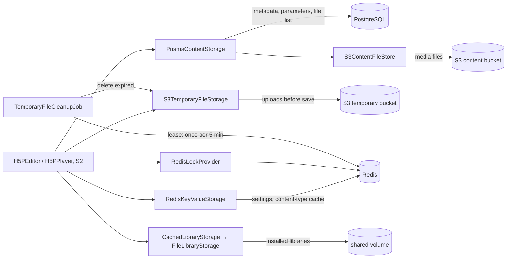
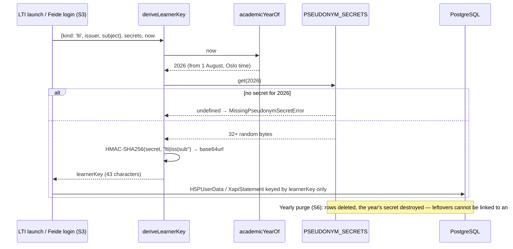

# apps/server

## Purpose

The back end of HVL Interaktiv. It runs the H5P engine (Core API 1.28) for authoring and playing the ten
content types, stores activities and learner progress, and (from later sessions) handles Feide login, LTI 1.3
launches from Canvas, the validator and teacher insight. It holds no learner names or e-mail addresses:
learners are yearly pseudonyms (`DATA-002`).

**Session 1 status.** The foundations are in place: validated configuration, privacy-safe logging,
learner pseudonyms, server messages in Nynorsk, Bokmål and English, the full database schema with its first
migration, the H5P configuration and startup check, the production storage adapters, and the package
archive guard. There is no HTTP server yet; Session 2 adds Express and the H5P routes.

## How to run

```bash
# once
npm install                                  # from the repository root
cp apps/server/.env.example apps/server/.env # local settings; matches docker-compose.yml
docker compose up -d                         # PostgreSQL 16, Redis 7, S3 emulator
npm run h5p:fetch-core                       # H5P core 1.28.0 + pinned editor, verified (D-027)
npm run db:generate --workspace apps/server  # Prisma client into src/generated/
npm run db:migrate                           # apply prisma/migrations

# every day
npm run boot-check --workspace apps/server   # proves the H5P engine would start (logs core 1.28 + Hub host);
                                             # needs only the fetched H5P files, no services or .env
npx vitest run --project server              # unit + integration tests (integration tests need the services)
npm run typecheck
```

Integration tests (`*.int.test.ts`) are skipped with a warning that names the missing variables when
`DATABASE_URL`, `REDIS_URL`, the S3 credentials or `PSEUDONYM_SECRETS` are not set; in CI (`CI=true`) a
missing variable fails the run instead (D-023).

## Folder structure

| Path | Responsibility |
|---|---|
| `src/config/env.ts` | The zod schema of every environment variable; startup fails with the variable's name |
| `src/config/productionChecks.ts` | Extra startup rules for `NODE_ENV=production` (a current-year pseudonym secret exists; no pseudonym secret is readable text or low in distinct bytes) |
| `src/logging/` | pino logger with key-based redaction (sensitive keys, endings and Feide attributes) and pattern-based redaction of credentials and e-mail addresses in free text; Prisma errors are logged by name and code only, in `err` and in `msg`. Names in free text cannot be detected, so callers never put them in messages |
| `src/privacy/` | Academic-year boundary, pseudonym secrets, `deriveLearnerKey` (HMAC-SHA256) |
| `src/i18n/` | Server messages in `nn` (default), `nb`, `en`, and the typed `t()` lookup |
| `src/infra/` | Clients: Prisma (PostgreSQL), Redis, S3 |
| `src/h5p/H5pConfigFactory.ts` | H5P config: Core 1.28, hub-api.h5p.org, 50 MB / 200 MB limits, allowlist; only harmless stored settings survive loading |
| `src/h5p/coreVersionCheck.ts`, `h5pServerInit.ts`, `bootCheck.ts` | Refuse to start when the fetched core files are not API 1.28 |
| `src/h5p/h5pStorage.ts` | Builds every storage adapter from the clients (the `H5P-004` table) |
| `src/h5p/storage/` | The adapters: content (PostgreSQL + S3), temporary files (S3), settings (Redis), libraries |
| `src/h5p/jobs/` | `TemporaryFileCleanupJob`: every 5 minutes, once per interval across all nodes |
| `src/security/zipEntryGuard.ts` | Rejects zip-slip, absolute paths, symlinks and oversize packages before extraction |
| `prisma/schema/*.prisma` | Database schema, one file per domain; described field by field in `docs/privacy/DATA-INVENTORY.md` |
| `prisma/migrations/` | Generated SQL migrations (plus one hand-written CHECK constraint, marked in the file) |
| `h5p/core`, `h5p/editor` | H5P client files, fetched and verified; not in git |
| `src/generated/` | Generated Prisma client; not in git |
| `test/` | Vitest tests; titles start with the requirement ID, e.g. `[DATA-002] …` |

## Key flows

**Startup (today: `npm run boot-check`; from S2 also the HTTP server).**



**Where H5P data is stored (`H5P-004`).**



**Learner pseudonym (`DATA-002`).** The raw Feide ID or LTI `iss`/`sub` exists only during the request
(the callers arrive with Feide login and LTI launch in S3):



## Configuration

Every variable is listed, with purpose, whether it is secret, its default and an example, in
[`.env.example`](.env.example) (`DOC-008`). The schema in `src/config/env.ts` is the single source; doc-lint
fails if the two disagree. Summary:

| Variable | Secret | Purpose |
|---|---|---|
| `DATABASE_URL` | yes | PostgreSQL connection |
| `REDIS_URL` | yes* | Shared cache, locks, job leases |
| `S3_ENDPOINT`, `S3_REGION`, `S3_FORCE_PATH_STYLE` | no | S3-compatible storage location |
| `S3_ACCESS_KEY_ID`, `S3_SECRET_ACCESS_KEY` | yes | S3 credentials |
| `S3_CONTENT_BUCKET`, `S3_TEMPORARY_BUCKET` | no | Buckets for activity files and editor uploads |
| `H5P_CORE_DIR`, `H5P_EDITOR_DIR`, `H5P_LIBRARY_DIR` | no | H5P client files and installed libraries |
| `H5P_SITE_UUID` | no | Pre-registered Hub site (workaround F2) |
| `PSEUDONYM_SECRETS` | yes | One HMAC secret per academic year |
| `NODE_ENV`, `LOG_LEVEL` | no | Runtime mode and log level |

\* when the URL contains a password.

## Implements

| Requirement | Where | Tests |
|---|---|---|
| `H5P-001` Core 1.28 and the new Hub | `src/h5p/H5pConfigFactory.ts`, `coreVersionCheck.ts`, `h5pServerInit.ts`, `bootCheck.ts` | `test/h5p/H5pConfigFactory.test.ts`, `test/h5p/h5pServerInit.test.ts` |
| `H5P-004` Production storage adapters | `src/h5p/h5pStorage.ts`, `src/h5p/storage/*`, `src/h5p/jobs/*` | `test/h5p/contentStorage.int.test.ts`, `test/h5p/sharedState.int.test.ts`, `test/h5p/S3TemporaryFileStorage.test.ts`, `test/h5p/s3Objects.test.ts`, `test/h5p/cleanupJob.test.ts`, `test/h5p/libraryStorageFactory.test.ts` |
| `SEC-002` Narrowed allowlist (value only; sniffing in S2) | `src/h5p/H5pConfigFactory.ts` | `test/h5p/H5pConfigFactory.test.ts` |
| `SEC-005` Size limits and archive safety | `src/security/zipEntryGuard.ts`, `src/h5p/storage/s3Objects.ts` | `test/security/zipEntryGuard.test.ts`, `test/h5p/s3Objects.test.ts` |
| `DATA-001` Data inventory | `prisma/schema/*.prisma`, `prisma.config.ts` | `tools/privacy/test/checkInventory.test.mjs`, `test/db/schema.int.test.ts` |
| `DATA-002` Pseudonymous learners | `src/privacy/*`, `src/config/productionChecks.ts`, CHECK constraint in the first migration | `test/privacy/deriveLearnerKey.test.ts`, `test/config/env.test.ts`, `test/db/schema.int.test.ts` |
| `DATA-009`, `NFR-006` No personal data in logs | `src/logging/*` | `test/logging/logger.test.ts`, `test/logging/loggerMessages.test.ts`, `test/logging/redactText.test.ts` |
| `PROD-012`, `DOC-009` Three languages, Nynorsk first | `src/i18n/*` | `test/i18n/translate.test.ts` |
| `DOC-008` Configuration documented | `src/config/env.ts`, `.env.example` | `test/config/env.test.ts` |

Decisions that shape this package: D-023 (test services), D-024 (TypeScript 6.0), D-025 (own S3 adapters),
D-026 (library storage), D-027 (fetched H5P files), D-028 (user-data adapter in S2), D-030 (accepted
`image-size` advisory), D-031 (S1 items finished in S2), D-032 (`h5p-express` and its Express override).
