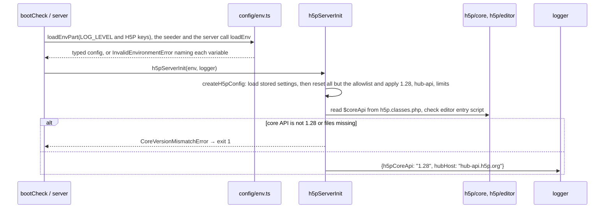
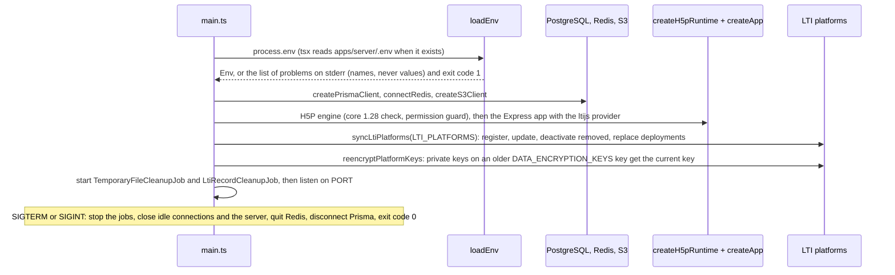
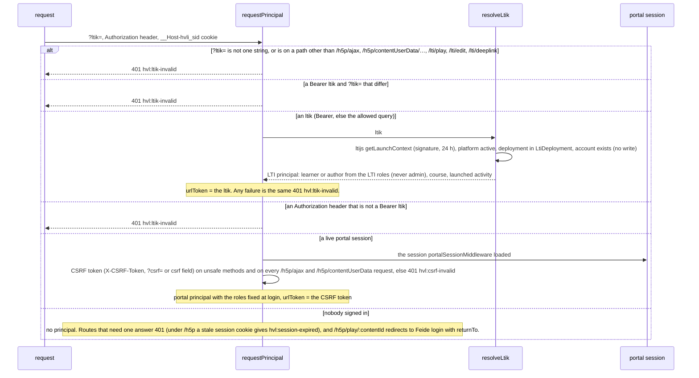
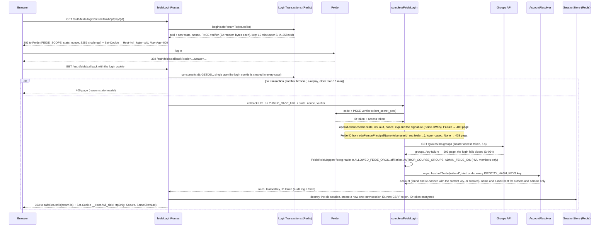
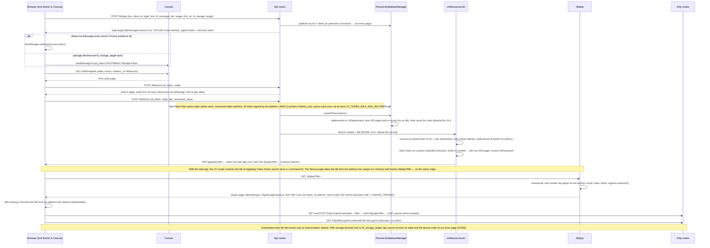
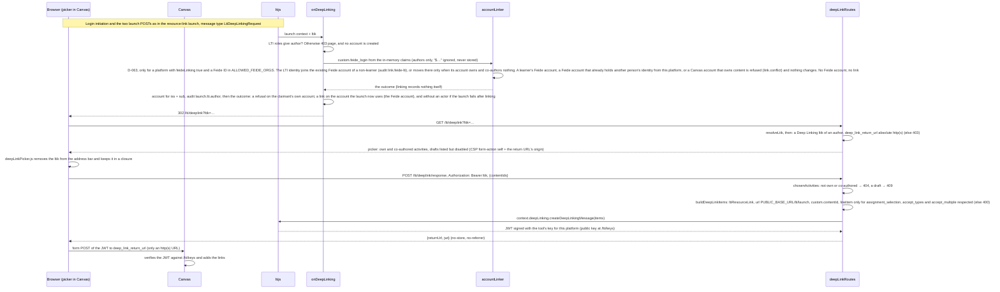
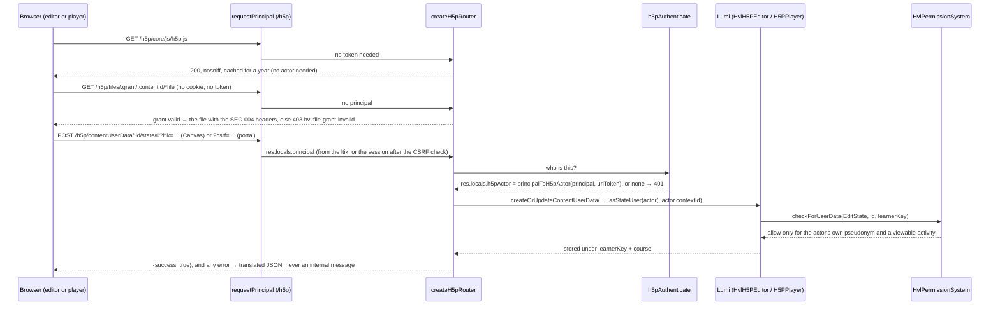
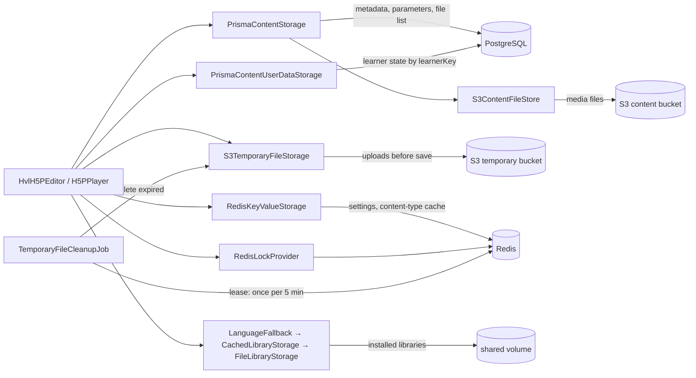
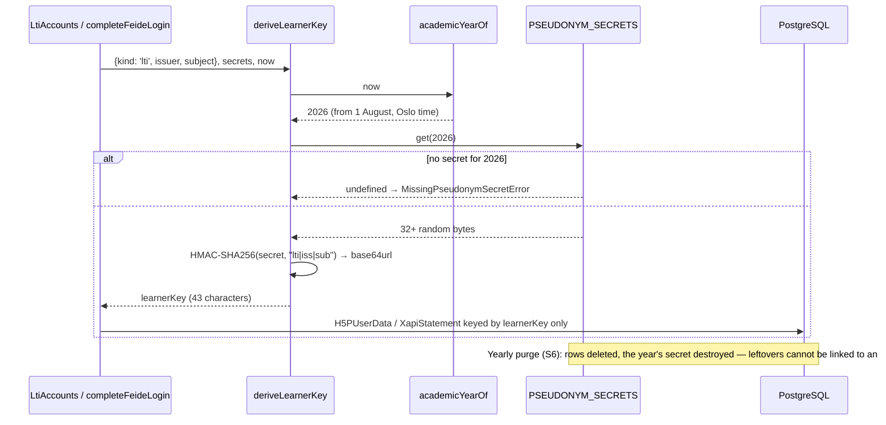

# apps/server

## Purpose

The back end of HVL Interaktiv. It runs the H5P engine (Core API 1.28) for authoring and playing the ten
content types, stores activities and learner progress, signs people in through Feide (the portal) and LTI 1.3
launches from Canvas, runs the pre-publish validator and the publish flow, serves the web app (`apps/web`) in its
own process, and (from S6) teacher insight. It holds no learner names or e-mail addresses: learners are yearly
pseudonyms (`DATA-002`).

**Status after Session 4 (in its gate).** On top of the Session 1 foundations (configuration, privacy-safe
logging, pseudonyms, messages in nn/nb/en, schema, storage adapters, archive guard) and the Session 2 H5P engine
(the ten content types only, HVL's permission system, learner state under the pseudonym, upload sniffing and SVG
sanitising, offline seeding, our own Express 5 routes), the server listens: `npm start` runs
`src/server/main.ts`. It has:

- **Feide login** for the portal: OpenID Connect code flow with PKCE, roles from the Feide Groups API, Redis
  sessions with a CSRF token, logout through Feide's end-session endpoint.
- **LTI 1.3 for Canvas** on ltijs 7: resource-link launches that land on the web app's Canvas page `/app/play`
  (on the H5P player `/lti/play` with `WEB_APP=off`), the editor inside Canvas (`/lti/edit`), the Deep Linking
  picker (`/lti/deeplink`), deployment checks, and ltijs storage on PostgreSQL. The ltik never sits in a cookie or
  in storage.
- **One `Principal`** for both entry points. The H5P routes and the `/api` routes (me and notices, the content
  list, findings, publish and unpublish, sharing, and `/api/docs` outside production) authenticate with it, and
  content files and editor uploads load through signed URLs in a cookie-less iframe.
- **The H5P player and editor pages** (`/h5p/play/:id`, `/h5p/edit/:id`, `/h5p/new`, and in Canvas `/lti/play`,
  `/lti/edit`) under a strict script policy (D-070), with HVL's H5P theme, the answer prefixes and the markup
  repairs in every document H5P renders (D-072, D-080). The real content types come from GitHub (D-078).
- **The pre-publish validator and the publish flow** with acknowledgements, a save gate for published activities
  and a Redis write lock (D-073, D-074).
- **The web app** (`apps/web`, Next.js) in the same process when `WEB_APP` is `dev` or `prod` (D-068): Express hands
  it every GET and HEAD request it does not answer itself, without cookies, tokens or the ltik, with a nonce policy.
- **Account linking** of an author's Canvas and Feide identities, an authentication audit, and a health check
  (`/healthz`).

The Deep Linking picker and the friendly error pages stay server-rendered by Express, styled with the design tokens
and, when the web app runs, with the **Hjelp** header (D-067). With `WEB_APP=off`, as in the integration tests, `/`
is a server-rendered start page and launches land on `/lti/play` as in S3.

## How to run

```bash
# once
npm install                                  # from the repository root
cp apps/server/.env.example apps/server/.env # local settings; matches docker-compose.yml
docker compose up -d                         # PostgreSQL 16, Redis 7, S3 emulator
npm run h5p:fetch-core                       # H5P core 1.28.0 + pinned editor, verified (D-027)
npm run db:generate --workspace apps/server  # Prisma client into src/generated/
npm run db:migrate                           # apply prisma/migrations
npx playwright-core install chromium         # full Chromium for browser and e2e tests (never --only-shell, D-065)

# every day
npm run boot-check --workspace apps/server   # proves the H5P engine would start (logs core 1.28 + Hub host);
                                             # needs only the fetched H5P files, no services or .env
npx vitest run --project server              # unit + integration + browser tests (need the services, Chromium)
npm run test:e2e                             # Chromium flows (D-065): cookie-less Canvas iframe launch → play →
                                             # resume, Deep Linking, portal sharing + logout, the editor in the
                                             # Canvas iframe; on the built web app with the real types: publishing
                                             # with a reason and the Canvas page /app/play with Rediger
npm run build && npm run test:a11y           # accessibility suite (UD-030, D-079): axe WCAG 2.2 AA, keyboard, reflow, motion,
                                             # target size, lang, first-party requests; needs the built web app, the real H5P
                                             # packages and Chromium; run it on its own (about 15 min)
npm run typecheck
npm run seed:libraries                       # install the content types from the verified seed packages (offline)
npm run h5p:fetch-libraries                  # the ten real types from GitHub at pinned commits (D-078), into var/h5p-real/;
                                             # a cached checkout is reused only while its HEAD is the pinned commit
npm run seed:libraries -- var/h5p-real/packages  # install those real types (what the editor and the a11y suite use)
npm run docs:api                             # browsable API docs into docs/api/ (TypeDoc)
NODE_USE_ENV_PROXY=1 npm run hub:check       # spike step 3: Hub registration and versions (needs the Hub)

# the whole server against the mock Feide and the mock Canvas (tools/mock-platform, D-049)
npm run mock:platform                        # terminal 1: mock Canvas on http://127.0.0.1:4100, mock Feide on
                                             # http://localhost:4200; prints the .env lines; Ctrl+C stops it
npm start                                    # terminal 2: tsx src/server/main.ts (no build step), port PORT (3000)
curl http://localhost:3000/healthz           # {"status":"ok"}, or 503 {"status":"unavailable","failing":[…]}
```

**Pointing `.env` at the mock.** `.env.example` already holds the mock's values for the fixed ports of
`npm run mock:platform` (mock Feide client ID, mock Canvas client and deployment IDs). The mock also prints six
lines (`FEIDE_ISSUER`, `FEIDE_GROUPS_API_URL`, `FEIDE_CLIENT_ID`, `FEIDE_CLIENT_SECRET`, `CANVAS_ORIGINS`,
`LTI_PLATFORMS` as single-quoted JSON); paste them into `apps/server/.env` only if you changed ports or IDs, since
the mock checks the client IDs. Then start the server (it registers the mock Canvas from `LTI_PLATFORMS` at
start-up) and open:

- `http://127.0.0.1:4100/`: the mock Canvas home page, with a resource-link launch for a `contentId` and the
  three Deep Linking placements. The course page frames the tool cross-site, as Canvas does.
- `http://localhost:3000/`: the start page with Feide login. The mock logs in `author` unless you choose another
  user first with `http://localhost:4200/__mock/next-login?user=<key>` (users are listed in
  [`tools/mock-platform/README.md`](../../tools/mock-platform/README.md)).

Use `localhost` for the tool, not `127.0.0.1`: the tool is then on the same site as the mock Feide and on another
site than the mock Canvas, and Chromium stores the `__Host-` cookies on `http://localhost` (pinned in
`test/browser/thirdPartyCookies.browser.test.ts`).

Integration tests (`*.int.test.ts`) and the e2e tests are skipped with a warning that names the missing variables
when one of the variables listed in `test/support/services.ts` is not set (`DATABASE_URL`, `REDIS_URL`, the S3
credentials, `PSEUDONYM_SECRETS`, `FEIDE_CLIENT_ID`, `FEIDE_CLIENT_SECRET` and the three key rings); in CI
(`CI=true`) a missing variable fails the run instead (D-023). They start the mock platform in-process
(`test/support/appTestbed.ts`), so `npm run mock:platform` is not needed for them. The e2e tests use the shared
test database one file at a time.

## Folder structure

| Path | Responsibility |
|---|---|
| `src/server/main.ts` | `npm start`: configuration, clients, H5P engine, app, LTI platform sync and key re-encryption, cleanup jobs, then listen on `PORT`; SIGTERM/SIGINT stop it with exit code 0 |
| `src/server/createApp.ts` | Builds the Express app in the mount order the security rules need (see Key flows) |
| `src/server/healthRoutes.ts` | `GET /healthz`: 200 when PostgreSQL and Redis answer within 2 s, else 503 with the names of the failing dependencies only |
| `src/config/env.ts`, `envParsers.ts` | The zod schema of every environment variable (lists, origins, key rings, `LTI_PLATFORMS` JSON); startup fails with the variable's name |
| `src/config/productionChecks.ts` | Extra startup rules for `NODE_ENV=production`: a current-year pseudonym secret exists; no pseudonym secret or ring key is readable text, low in distinct bytes or used twice; every public, Feide, Canvas and LTI platform URL is https |
| `src/security/keys/` | Key rings with HKDF purpose keys (D-055, D-056, D-058): stable identity hashes with rotation, AES-256-GCM encryption of secrets at rest |
| `src/auth/Principal.ts`, `principalLocals.ts` | The one `Principal` of a portal or LTI request (D-053); `sealPrincipal` refuses an LTI admin; routes read the principal from `res.locals` only |
| `src/auth/requestPrincipal.ts` | The authentication middleware of `/api` and `/h5p`: an ltik (Bearer, or the query only on the paths of `LTIK_QUERY_PATHS`: `/h5p/ajax`, `/h5p/contentUserData/…` and the pages `/lti/play`, `/lti/edit`, `/lti/deeplink`, D-058, D-069) or the portal session with its CSRF token |
| `src/auth/principalToH5pActor.ts` | The one mapping from a `Principal` to the H5P actor: highest role, learnerKey, Canvas course, launched activity, URL token |
| `src/auth/returnTo.ts` | Reduces an untrusted "after login" target to a local path or `/`, so login is never an open redirect |
| `src/auth/feide/` | The Feide relying party (openid-client 6, PKCE S256, `client_secret_post`), login transactions, Groups API call, role mapping, Feide ID and author profile from the claims, login completion, and the `/auth/*` routes |
| `src/auth/session/` | Portal sessions in Redis behind `__Host-hvli_sid` (idle 2 h, absolute 12 h), the two cookies, opaque IDs, the synchronizer CSRF token (D-057) |
| `src/auth/identity/` | Accounts found by keyed identity hash with key rotation (D-055), the one subject text for hashes and learnerKey, Canvas–Feide account linking for platforms with `feideLinking` (AUTH-005, D-063) |
| `src/auth/audit/` | `AuthAuditRecorder`: login, logout, author-launch and link events from fixed lists; logins, logouts and failed launches carry a keyed IP hash (D-064) |
| `src/lti/LtiProviderFactory.ts`, `ltiRoutes.ts` | The ltijs 7 `Provider` on our router, storage, cache and logger (D-050), and the `/lti` router: ltijs routes, launch handlers, player, picker, LTI error pages |
| `src/lti/http/` | `ExpressRouterHttpHandler` (ltijs's routes on an Express router, `listen` never called), the LTI page headers (no-store, no-referrer, `frame-ancestors` from `CANVAS_ORIGINS`, plus `'self'` for `/lti/play` and `/lti/edit` and their error pages, which `/app/play` frames), the friendly LTI error pages |
| `src/lti/storage/` | ltijs's `DatabaseManager` on PostgreSQL (deployment check and claim allowlist in `saveIdToken`, encrypted private keys and access tokens), the node-redis `LtiCacheManager`, record lifetimes, `LtiRecordCleanupJob` (D-052) |
| `src/lti/platforms/` | `syncLtiPlatforms` (`LTI_PLATFORMS` at start-up), `LtiDeploymentGuard`, `reencryptPlatformKeys` (D-051, D-056) |
| `src/lti/launch/` | `onResourceLink` and `onDeepLinking`, and `LtiAccounts`: the account and learnerKey of a launch (created only at a launch) |
| `src/lti/placements/` | `LtiPlacementRecorder`: one `LtiPlacement` per platform, course and resource link |
| `src/lti/deepLinking/` | The picker and response routes, the activities an author may place, and the content items (D-061) |
| `src/lti/play/` | `/lti/play` (the H5P player inside Canvas), `/lti/edit` (the editor inside Canvas, LTI-006 **Rediger**) and the static page scripts under `/static/lti` |
| `src/web/` | The web app (`apps/web`, Next.js) in the server's process: loader, nonce policy, and the request contract that removes cookies, tokens and the `ltik` query before Next.js sees a request or a development-server WebSocket upgrade (D-068, D-070) |
| `src/lti/pages/` | The picker HTML. `client/`: the static page scripts `ltikLanding.js` (removes the ltik from the address bar), `deepLinkPicker.js`, `ltijsStorageGuard.js` and `h5pStorageGuard.js` (D-050); ESLint forbids storage APIs and cookies there |
| `src/lti/ltikPrincipal.ts` | ltik → `Principal`, with the platform-active, deployment and account checks ltijs does not make (D-050, D-051) |
| `src/lti/LtiRoleMapper.ts`, `launchFacts.ts`, `ltiLocale.ts`, `ltijsLogger.ts` | LTI roles → `learner` or `author`, never `admin` (D-059); the launch facts (course = `launch.context.id`); UI language; ltijs's log calls through pino |
| `src/logging/` | pino logger with key-based redaction (sensitive keys, endings and Feide attributes) and pattern-based redaction of credentials and e-mail addresses in free text; Prisma errors are logged by name and code only, in `err` and in `msg`. Names in free text cannot be detected, so callers never put them in messages |
| `src/privacy/` | Academic-year boundary, pseudonym secrets, `deriveLearnerKey` (HMAC-SHA256) |
| `src/i18n/` | Server messages in `nn` (default), `nb`, `en`, and the typed `t()` lookup |
| `src/infra/` | Clients: Prisma (PostgreSQL), Redis, S3 |
| `src/jobs/LeasedIntervalJob.ts` | A timer that does its work on one node per interval under a Redis lease (H5P temporary files, ltijs records) |
| `src/h5p/H5pConfigFactory.ts` | H5P config: Core 1.28, hub-api.h5p.org, 50 MB / 200 MB limits, allowlist, finished data off, 5 s state saves; only harmless stored settings survive loading |
| `src/h5p/createH5pRuntime.ts` | Builds the whole engine once: config check, storages, permission system, sanitisers, URL generator, editor, player, guard |
| `src/h5p/H5pEditorFactory.ts`, `H5pPlayerFactory.ts`, `h5pAssets.ts` | Every engine option HVL depends on (F1 local ID, F3 Core 1.28 styles, language fallback, renderers); the player refuses render options that skip the View check |
| `src/h5p/HvlUrlGenerator.ts`, `contentFileGrants.ts` | H5P URLs with the request's ltik or CSRF token (URL-encoded), and signed content-file grants (`URL_SIGNING_KEYS`, 12–13 h) in `contentUrl` (D-058) |
| `src/h5p/HvlH5PEditor.ts`, `HvlTop10ContentTypeFilter.ts`, `semantics/` | The ten types, DragQuestion removal, sub-content policy, save order, package import rules |
| `src/h5p/HvlPermissionSystem.ts`, `permissions/`, `permissionSystemGuard.ts`, `HvlH5pUser.ts` | Who may do what (`H5P-006`, with D-060 for launched activities), the actor's account and state views (D-036), and the start-up check that every Lumi component uses it |
| `src/h5p/HvlTranslationCallback.ts`, `h5pTranslationResources.ts` | Lumi's strings in nn → nb → en (`H5P-008`) |
| `src/h5p/libraries/` | Package manifest and version checks, library audit, the offline seeder (`seed:libraries`) |
| `src/h5p/render/` | Our player page with script-safe JSON in an inert data block read by `client/h5pIntegration.js` (D-040, D-070); the LTI player puts its two page scripts first; `coreInlineScripts.ts` hashes H5P Core's one inline script for the page CSP |
| `src/h5p/hubCheck.ts` | `hub:check`: registration and Hub versions, on demand only (D-041) |
| `src/http/` | `createH5pRouter`: public client files, then the grant-checked content files and editor uploads, then `h5pAuthenticate`, the AJAX, file, state, content, player and editor-page routes (`/h5p/edit/:id`, `/h5p/new`), and the translated error handler; `editorView.ts` (the Edit check, then the editor page with grants, shared by portal and Canvas); `securityHeaders.ts` (headers of every response), `h5pPageCsp.ts` (the strict policy of the pages that run H5P, D-070), `authErrors.ts` (one status and message per refusal code) |
| `src/http/pages/` | Server-rendered pages with an escaping `markup` template, the friendly message page, the S3 start page `/` and the HTML 404 page (D-048, D-066), all with a first-party policy (`portalPageCsp`, DATA-011); `helpLink.ts` gives them the header with **Hjelp** when the web app runs (UD-013, D-067) |
| `src/http/api/` | The `/api` router (`apiRouter.ts`): `GET /api/me`, `PUT /api/me/notices/:noticeId`, the content list and detail, findings, publish and unpublish, sharing, and `/api/docs` outside production; bodies are checked with `@hvl-interaktiv/api-contract` (DOC-012, D-074, D-075, D-077) |
| `src/content/` | The publish flow: acknowledgement coverage (14 days), stored-content validation, `ContentPublisher` (one conditional transaction with audit), `PublishedSaveGate` (the gate and the version count on saves), access from the H5P-006 matrix, content summaries (D-074) |
| `src/validation/` | The pure pre-publish validator (UD-020, D-073): shape-based walk (`contentWalker.ts`), htmlparser2 rich text (`richText.ts`), one rule per file in `rules/` (11 V-* UD-021 rules, 11 PED-H* hints), messages in `locales/`, `validateContent` / `createContentValidator`, `activityLanguage` |
| `src/config/validationContext.ts` | Loads `content/laeringsdesign/hint-thresholds.yaml` (zod) and `CAPTIONED_MEDIA_ORIGINS` once at start-up; a bad key stops the server |
| `src/http/pages/assets/`, `pageAssetRoutes.ts` | The server pages' stylesheets at `/static/pages/` (token CSS, D-067): `serverPages.css` (also on the editor's outer page) and `serverChrome.css` (skip link and Hjelp header) |
| `src/h5p/coreVersionCheck.ts`, `h5pServerInit.ts`, `bootCheck.ts` | Refuse to start when the fetched core files are not API 1.28 |
| `src/h5p/h5pStorage.ts` | Builds every storage adapter from the clients (the `H5P-004` table) |
| `src/h5p/storage/` | The adapters: content (PostgreSQL + S3), temporary files (S3), settings (Redis), libraries (with the nn → nb fallback), learner state (PostgreSQL, by pseudonym) |
| `src/h5p/jobs/` | `TemporaryFileCleanupJob`: every 5 minutes, once per interval across all nodes |
| `src/security/zipEntryGuard.ts` | Rejects zip-slip, absolute paths, symlinks and oversize packages before extraction |
| `src/security/FileTypeSniffer.ts`, `sniff/` | Refuses files whose bytes do not match their extension (`SEC-002`) |
| `src/security/SvgSanitizer.ts`, `svg/` | Pre-check, Lumi's sanitiser, DOMPurify pass and final XML check for SVGs (`SEC-001`, D-044) |
| `src/security/ContentFileHeaders.ts` | Content-Type, `nosniff`, sandbox CSP and disposition for every user file (`SEC-004`, D-045) |
| `prisma/schema/*.prisma` | Database schema, one file per domain; described field by field in `docs/privacy/DATA-INVENTORY.md` |
| `prisma/migrations/` | Generated SQL migrations (plus one hand-written CHECK constraint, marked in the file) |
| `h5p/core`, `h5p/editor` | H5P client files, fetched and verified; not in git |
| `src/generated/` | Generated Prisma client; not in git |
| `test/` | Vitest tests; titles start with the requirement ID, e.g. `[DATA-002] …` |
| `test/support/appTestbed.ts`, `ltiLaunchDriver.ts` | The whole app on a real port with the mock platform pointed at it, and an LTI launch through the real ltijs routes without a browser |
| `vitest.e2e.config.ts`, `e2e/` | The Chromium flows of `npm run test:e2e` (D-065): from S3 the Canvas iframe launch, Deep Linking and portal sharing; from S4 the editor in the Canvas iframe, publishing with a reason and the Canvas page `/app/play` (the last two on the built web app with the real types), the check of what a failed flow reports (`flowRecord.e2e.test.ts`), and the check that a closed test bed removes what it created and keeps an account an earlier run left (`testbedCleanup.e2e.test.ts`). The Canvas flows run in full Chromium with third-party cookies blocked |
| `vitest.a11y.config.ts`, `a11y/` | The accessibility suite of `npm run test:a11y` (UD-030); `a11y/support/upstreamRegister.ts` lists the H5P upstream violations it reports but cannot repair |
| `test/support/realWebApp.ts` | The whole server with the built web app, the ten real H5P types, a signed-in Feide author and LTI launches, for the browser suites |
| [`../../tools/mock-platform/`](../../tools/mock-platform/README.md) | The mock Feide and mock Canvas that the tests and `npm run mock:platform` use (D-049) |

## Key flows

**H5P engine start-up (`npm run boot-check`, the seeder, and `npm start` through `createH5pRuntime`).**



**Server start (`npm start`, `src/server/main.ts`).** ltijs never listens itself (D-050), and the platforms are
in place before the first launch can arrive (D-051):



**Mount order (`createApp`).** Each stage either answers or passes the request on, so the order decides which
checks a request meets:

```mermaid
flowchart TD
    In([request]) --> TP["trust proxy: TRUST_PROXY hops"]
    TP --> BH["base headers: nosniff, no-referrer, HSTS when PUBLIC_BASE_URL is https"]
    BH --> HZ["GET /healthz"]
    HZ --> PA["page assets: /static/pages (the server pages' token CSS)"]
    PA --> CR["web app only: the Hjelp marker (offerHelpLink), then chromeRedirect (a top-level navigation to an H5P page → 303 to its chrome page)"]
    CR --> PS["portal session: __Host-hvli_sid → session in res.locals, or none"]
    PS --> LTI["LTI router: ltijs /lti/login, /lti/launch, /lti/keys → /static/lti, /lti/play → /app/play (web app only) → /lti/edit → /lti/deeplink, /lti/deeplink/response → LTI error pages"]
    LTI --> FE["Feide routes: /auth/feide/login, /auth/feide/callback, /auth/logout, /auth/session, /auth/logged-out"]
    FE --> HOME["GET / (the server's start page, only with WEB_APP=off)"]
    HOME --> API["/api: requestPrincipal → me and notices, content list, findings, publish and unpublish, sharing, /api/docs outside production → JSON 404 and errors"]
    API --> H5P["/h5p: requestPrincipal → createH5pRouter (client files, signed files and uploads, h5pAuthenticate, H5P routes, player and editor pages)"]
    H5P --> WEB["web app only: Next.js for GET and HEAD, with a nonce policy, without cookies, tokens or the ltik"]
    WEB --> NF["HTML 404 page"]
    NF --> ERR["last-resort error page"]
```



**Who is making the request (`requestPrincipal`, on `/api` and `/h5p`).** An ltik wins over a session cookie,
so inside Canvas a portal cookie never changes who a request acts as:



**Feide login (`AUTH-001`…`AUTH-004`).** The login-transaction cookie binds the callback to the browser that
started the login (D-057). Every refusal is audited as `login.feide.failed` with a fixed reason (D-064):



**LTI resource-link launch in a cookie-less Canvas iframe (`LTI-001`, `LTI-003`, `LTI-006`).** ltijs's
short-lived recovery token may sit in the frame's storage or in Canvas's Platform Storage; the ltik never does
(D-050):



**Deep Linking (`LTI-005`, `PROD-005`, `AUTH-005`).** The teacher picks activities in Canvas, and the tool returns
a signed `LtiDeepLinkingResponse` (D-061):



**An H5P request (`createH5pRouter`).** Public client files and grant-checked content files are served first;
every other route needs the actor that `h5pAuthenticate` builds from the principal, and Lumi asks HVL's
permission system before it acts:



**Where H5P data is stored (`H5P-004`).**



**Learner pseudonym (`DATA-002`).** The raw Feide ID or LTI `iss`/`sub` exists only during the login or launch
request. The callers are `completeFeideLogin` and `LtiAccounts` (`src/lti/launch/ltiAccount.ts`), and
`src/auth/identity/subjectSources.ts` builds the text for both the learnerKey and the identity hash:



## Configuration

Every variable is listed, with purpose, whether it is secret, its default and an example, in
[`.env.example`](.env.example) (`DOC-008`). The schema in `src/config/env.ts` is the single source; doc-lint
fails if the two disagree. Summary:

| Variable | Secret | Purpose |
|---|---|---|
| `DATABASE_URL` | yes | PostgreSQL connection |
| `REDIS_URL` | yes* | Shared cache, locks, job leases, portal sessions, login transactions, ltijs key cache |
| `S3_ENDPOINT`, `S3_REGION`, `S3_FORCE_PATH_STYLE` | no | S3-compatible storage location |
| `S3_ACCESS_KEY_ID`, `S3_SECRET_ACCESS_KEY` | yes | S3 credentials |
| `S3_CONTENT_BUCKET`, `S3_TEMPORARY_BUCKET` | no | Buckets for activity files and editor uploads |
| `H5P_CORE_DIR`, `H5P_EDITOR_DIR`, `H5P_LIBRARY_DIR` | no | H5P client files and installed libraries |
| `H5P_SITE_UUID` | no | Pre-registered Hub site (workaround F2) |
| `PSEUDONYM_SECRETS` | yes | One HMAC secret per academic year |
| `NODE_ENV`, `LOG_LEVEL` | no | Runtime mode and log level |
| `PUBLIC_BASE_URL` | no | The public origin (no path): Feide redirect URI `<origin>/auth/feide/callback`, logout return `<origin>/auth/logged-out`, Deep Linking item URLs, HSTS when https |
| `PORT` | no | The port the server listens on (default 3000) |
| `TRUST_PROXY` | no | How many reverse proxies' `X-Forwarded-*` headers are trusted (0–5, default 0); never more than really run |
| `CANVAS_ORIGINS` | no | Origins that may frame the LTI pages (`frame-ancestors`, comma-separated); empty: no framing |
| `EXTERNAL_MEDIA_ORIGINS` | no | Origins H5P content may load outside media from (e.g. Panopto); never YouTube. A Panopto site (`*.panopto.com`, `*.panopto.eu`) also allows Panopto's embed API script (that one file on `developers.panopto.com`), which H5P.Video needs (D-070) |
| `CAPTIONED_MEDIA_ORIGINS` | no | Origins whose videos are captioned by policy (e.g. HVL's Panopto); V-VID-CAPTIONS accepts their videos without a text track of their own (D-073) |
| `WEB_APP` | no | `off` (default), `dev` or `prod`: whether the server also serves `apps/web` in its own process (D-068); production refuses `dev` |
| `LTI_PLATFORMS` | no | The Canvas platforms and their deployment IDs as JSON, synced at start-up (D-051); a launch from an unlisted deployment gets no ltik. `"feideLinking": true` on a platform turns on Canvas–Feide account linking for it (default off, D-063) |
| `LTI_TOKEN_MAX_AGE_SECONDS` | no | Oldest accepted LTI ID token by its `iat` (1–60 s, default 10) |
| `FEIDE_ISSUER`, `FEIDE_CLIENT_ID` | no | Feide OpenID Connect issuer (discovery) and this server's client ID |
| `FEIDE_CLIENT_SECRET` | yes | The client secret, sent as `client_secret_post`; never logged |
| `FEIDE_GROUPS_API_URL` | no | Base URL of the Feide Groups API (`/groups/me/groups`) |
| `ALLOWED_FEIDE_ORGS` | no | Feide realms whose users are HVL members (default `hvl.no`); others are learners |
| `ADMIN_FEIDE_IDS` | no | Feide IDs that get `admin` at portal login, if they are HVL members; an LTI launch never grants it |
| `AUTHOR_COURSE_GROUPS` | no | Feide course groups whose students may author (exact or `prefix:` match, D-059) |
| `IDENTITY_HASH_KEYS` | yes | Key ring for `Identity.subjectHash` and the audit IP hash, current key first (D-055) |
| `DATA_ENCRYPTION_KEYS` | yes | Key ring for AES-256-GCM at rest: LTI private keys, LTI access tokens, the session's Feide ID token (D-056); rotate in three steps (new key second, then first, then drop the old one), see `.env.example` |
| `URL_SIGNING_KEYS` | yes | Key ring that signs content-file grants and editor upload grants (separate HKDF purposes, D-058, D-069) |

\* when the URL contains a password.

With `NODE_ENV=production`, `src/config/productionChecks.ts` also requires https for `PUBLIC_BASE_URL`, the Feide
URLs, `CANVAS_ORIGINS` and the `LTI_PLATFORMS` endpoints, and refuses ring keys that are readable text (like the
examples), low in distinct bytes or used twice. `.env.example` says how to rotate each key ring.

## Implements

| Requirement | Where | Tests |
|---|---|---|
| `H5P-001` Core 1.28 and the new Hub | `src/h5p/H5pConfigFactory.ts`, `coreVersionCheck.ts`, `h5pServerInit.ts`, `bootCheck.ts` | `test/h5p/H5pConfigFactory.test.ts`, `test/h5p/h5pServerInit.test.ts` |
| `H5P-004` Production storage adapters | `src/h5p/h5pStorage.ts`, `src/h5p/storage/*`, `src/h5p/jobs/*` | `test/h5p/contentStorage.int.test.ts`, `test/h5p/sharedState.int.test.ts`, `test/h5p/S3TemporaryFileStorage.test.ts`, `test/h5p/s3Objects.test.ts`, `test/h5p/cleanupJob.test.ts`, `test/h5p/libraryStorageFactory.test.ts` |
| `H5P-002`, `PROD-002`, `SEC-008` The ten types, no DragQuestion, inert markup | `src/h5p/HvlTop10ContentTypeFilter.ts`, `HvlH5PEditor.ts`, `semantics/*`, `render/*` | `test/h5p/HvlTop10ContentTypeFilter.test.ts`, `test/h5p/HvlH5PEditor*.test.ts`, `test/h5p/semantics/*`, `test/http/ajax.int.test.ts`, `test/http/contentSave.int.test.ts`, `test/http/player.int.test.ts` |
| `H5P-003`, `H5P-011` Offline seeding and library audit | `src/h5p/libraries/*` | `test/h5p/libraries/*`, `test/http/packageImport.int.test.ts` |
| `H5P-005`, `PROD-008` Resume learner state | `src/h5p/storage/PrismaContentUserDataStorage.ts`, `src/http/routes/userDataRoutes.ts` | `test/h5p/PrismaContentUserDataStorage*.int.test.ts`, `test/http/userData.int.test.ts`, `test/http/player.browser.int.test.ts` |
| `H5P-006` Permission system | `src/h5p/HvlPermissionSystem.ts`, `permissions/*`, `permissionSystemGuard.ts` | `test/h5p/permissions/*`, `test/h5p/HvlPermissionSystem.test.ts`, `test/h5p/permissionSystemGuard.test.ts`, `test/http/*.int.test.ts` |
| `H5P-008` Nynorsk first | `src/h5p/HvlTranslationCallback.ts`, `storage/LanguageFallbackLibraryStorage.ts` | `test/h5p/HvlTranslationCallback.test.ts`, `test/h5p/LanguageFallbackLibraryStorage.test.ts` |
| `SEC-001` SVG sanitising | `src/security/SvgSanitizer.ts`, `svg/*` | `test/security/SvgSanitizer*.test.ts`, `test/security/svgFinalCheck.test.ts`, `test/http/editorUpload.int.test.ts` |
| `SEC-002` Allowlist and type sniffing | `src/h5p/H5pConfigFactory.ts`, `src/security/FileTypeSniffer.ts`, `sniff/*` | `test/security/FileTypeSniffer*.test.ts`, `test/http/editorUpload.int.test.ts` |
| `SEC-003` Only admins install libraries | `src/h5p/HvlH5PEditor.ts`, `permissions/contentRules.ts` | `test/h5p/HvlH5PEditor.upload.test.ts`, `test/http/packageImport.int.test.ts`, `test/http/ajax.int.test.ts` |
| `SEC-004` Headers for user files | `src/security/ContentFileHeaders.ts`, `src/http/sendUserFile.ts`, `src/http/routes/signedFileRoutes.ts`, `src/http/securityHeaders.ts` | `test/security/ContentFileHeaders.test.ts`, `test/http/contentFiles.int.test.ts`, `test/http/signedFiles.int.test.ts`, `test/http/securityHeaders.test.ts` |
| `SEC-005` Size limits and archive safety | `src/security/zipEntryGuard.ts`, `src/h5p/storage/s3Objects.ts`, `src/http/multipartUpload.ts` | `test/security/zipEntryGuard.test.ts`, `test/h5p/s3Objects.test.ts`, `test/http/multipartUpload.test.ts` |
| `DATA-001` Data inventory | `prisma/schema/*.prisma`, `prisma.config.ts` | `tools/privacy/test/checkInventory.test.mjs`, `test/db/schema.int.test.ts` |
| `DATA-002` Pseudonymous learners | `src/privacy/*`, `src/config/productionChecks.ts`, `src/auth/identity/subjectSources.ts`, `AccountResolver.ts`, `src/lti/launch/ltiAccount.ts`, `src/lti/storage/ltiIdTokenClaims.ts`, `src/security/keys/IdentityHasher.ts`, CHECK constraint in the first migration | `test/privacy/deriveLearnerKey.test.ts`, `test/config/env.test.ts`, `test/db/schema.int.test.ts`, `test/auth/identity/subjectSources.test.ts`, `test/auth/identity/AccountResolver.int.test.ts`, `test/lti/launch/ltiAccount.int.test.ts`, `test/lti/storage/ltiIdTokenClaims.test.ts`, `test/security/keys/IdentityHasher.test.ts` |
| `DATA-009`, `NFR-006` No personal data in logs | `src/logging/*`, `src/lti/ltijsLogger.ts` | `test/logging/logger.test.ts`, `test/logging/loggerMessages.test.ts`, `test/logging/redactText.test.ts`, `test/logging/authRedaction.test.ts`, `test/lti/ltijsLogger.test.ts` |
| `PROD-012`, `DOC-009` Three languages, Nynorsk first | `src/i18n/*`, `src/lti/ltiLocale.ts` | `test/i18n/translate.test.ts`, `test/lti/ltiLocale.test.ts` |
| `DOC-008` Configuration documented | `src/config/env.ts`, `envParsers.ts`, `.env.example` | `test/config/env.test.ts`, `test/config/envParsers.test.ts` |
| `AUTH-001` Feide login (code flow + PKCE) | `src/auth/feide/FeideClient.ts`, `loginTransactions.ts`, `completeFeideLogin.ts`, `feideLoginRoutes.ts`, `src/auth/session/sessionCookies.ts`, `src/auth/audit/AuthAuditRecorder.ts` | `test/auth/feide/FeideClient.test.ts`, `test/auth/feide/loginTransactions.int.test.ts`, `test/auth/feide/feideLogin.int.test.ts`, `test/auth/upstream/openidClientMock.test.ts`, `test/auth/audit/AuthAuditRecorder.int.test.ts`, `test/config/productionChecks.test.ts` |
| `AUTH-002` Feide affiliation → roles | `src/auth/feide/FeideRoleMapper.ts`, `feideGroups.ts`, `feideClaims.ts`, `src/auth/Principal.ts` | `test/auth/feide/FeideRoleMapper*.test.ts`, `test/auth/feide/feideGroups.test.ts`, `test/auth/feide/feideClaims.test.ts`, `test/auth/feide/feideLogin.int.test.ts`, `test/auth/Principal.test.ts`, `test/config/envParsers.test.ts` |
| `AUTH-003` Portal session, CSRF, logout | `src/auth/session/*`, `src/auth/requestPrincipal.ts`, `src/auth/returnTo.ts`, `src/auth/feide/feideLoginRoutes.ts`, `src/http/h5pAuthenticate.ts` | `test/auth/session/*`, `test/auth/requestPrincipal.test.ts`, `test/auth/returnTo.test.ts`, `test/auth/feide/feideLogout.int.test.ts`, `test/auth/feide/loginTransactions.int.test.ts`, `test/http/h5pAuthenticate.int.test.ts`, `test/server/createApp.int.test.ts` |
| `AUTH-004` Data minimisation at login | `src/auth/feide/FeideClient.ts` (`FEIDE_SCOPE`), `feideClaims.ts`, `src/auth/identity/AccountResolver.ts` | `test/auth/feide/FeideClient.test.ts`, `test/auth/feide/feideClaims.test.ts`, `test/auth/feide/feideLogin.int.test.ts`, `test/auth/identity/AccountResolver.int.test.ts` |
| `AUTH-005` Canvas–Feide account linking | `src/auth/identity/linkDecision.ts`, `accountLinking.ts`, `identityLookup.ts`, `src/lti/launch/onDeepLinking.ts`, `src/lti/linkingPlatforms.ts` (`feideLinking`) | `test/auth/identity/linkDecision.test.ts`, `test/auth/identity/accountLinking.int.test.ts`, `test/auth/identity/accountLinkingGuards.int.test.ts`, `test/lti/linkingPlatforms.test.ts` |
| `LTI-001` LTI 1.3 tool with ltijs 7 | `src/lti/LtiProviderFactory.ts`, `ltiRoutes.ts`, `launchFacts.ts`, `http/*`, `platforms/syncLtiPlatforms.ts`, `platforms/LtiDeploymentGuard.ts`, `storage/LtiCacheManager.ts`, `src/server/main.ts` | `test/lti/ltiLaunch.int.test.ts`, `test/lti/upstream/ltijsProvider.test.ts`, `test/lti/http/ExpressRouterHttpHandler.test.ts`, `test/lti/http/ltiErrorPages.test.ts`, `test/lti/platforms/syncLtiPlatforms.int.test.ts`, `test/lti/storage/LtiDeploymentGuard.int.test.ts`, `test/lti/launchFacts.test.ts`, `test/lti/launch/ltiAccount.int.test.ts`, `test/db/ltiDeployments.int.test.ts`, `test/lti/storage/LtiCacheManager.int.test.ts` |
| `LTI-002` PostgreSQL storage for ltijs | `src/lti/storage/*`, `src/lti/platforms/reencryptPlatformKeys.ts`, `src/security/keys/DataEncryption.ts`, `src/jobs/LeasedIntervalJob.ts` | `test/lti/storage/PrismaLtiDatabaseManager.int.test.ts` (runs the `ltiDatabaseContract.ts` suite), `ltiSecretsAtRest.int.test.ts`, `ltiStorageRows.test.ts`, `ltiIdTokenClaims.test.ts`, `ltijsOnPrismaStorage.int.test.ts`, `ltijsResumedLaunch.int.test.ts`, `LtiRecordCleanupJob*.test.ts`, `test/lti/platforms/reencryptPlatformKeys.int.test.ts`, `test/security/keys/DataEncryption.test.ts`, `test/jobs/LeasedIntervalJob.test.ts` |
| `LTI-003` Cookie-less ltik transport | `src/auth/requestPrincipal.ts`, `src/lti/ltikPrincipal.ts`, `src/lti/http/ltiPageHeaders.ts`, `src/lti/play/ltiPlayRoutes.ts`, `src/lti/pages/client/*`, `src/http/securityHeaders.ts` | `test/auth/requestPrincipal.test.ts`, `test/lti/ltikPrincipal.int.test.ts`, `test/lti/http/ltiPageHeaders.test.ts`, `test/lti/pages/ltikLanding.test.ts`, `test/lti/ltiLaunch.int.test.ts`, `test/logging/authRedaction.test.ts`, `test/browser/thirdPartyCookies.browser.test.ts`, `e2e/ltiIframe.e2e.test.ts` |
| `LTI-004` LTI roles, never admin | `src/lti/LtiRoleMapper.ts`, `src/auth/Principal.ts` (`sealPrincipal`) | `test/lti/LtiRoleMapper.test.ts`, `test/auth/Principal.test.ts`, `test/lti/ltikPrincipal.int.test.ts`, `test/lti/deepLinking/deepLinking.int.test.ts` |
| `LTI-005`, `PROD-005` Deep Linking picker, place activities in Canvas | `src/lti/launch/onDeepLinking.ts`, `src/lti/deepLinking/*`, `src/lti/pages/deepLinkPickerPage.ts`, `client/deepLinkPicker.js` | `test/lti/deepLinking/*`, `test/lti/pages/deepLinkPickerPage.test.ts`, `test/lti/pages/deepLinkPicker.browser.test.ts`, `e2e/deepLinking.e2e.test.ts` |
| `LTI-006` Resource-link launch; the editor inside Canvas (the **Rediger** tab comes with the S4 chrome, D-062) | `src/lti/launch/onResourceLink.ts`, `src/lti/placements/LtiPlacementRecorder.ts`, `src/lti/play/ltiPlayRoutes.ts`, `src/lti/play/ltiEditRoutes.ts`, `src/http/editorView.ts` | `test/lti/ltiLaunch.int.test.ts`, `test/lti/placements/LtiPlacementRecorder.int.test.ts`, `test/lti/launchFacts.test.ts`, `test/lti/ltiEdit.int.test.ts`, `e2e/ltiEditor.e2e.test.ts` |
| `LTI-007` Works after a course copy | `src/auth/principalToH5pActor.ts`, `src/h5p/permissions/contentRules.ts` (D-060), `src/lti/placements/LtiPlacementRecorder.ts` | `test/lti/ltiPlay.int.test.ts`, `test/lti/placements/LtiPlacementRecorder.int.test.ts`, `test/auth/principalToH5pActor.test.ts`, `test/h5p/permissions/contentMatrix.test.ts` |
| `H5P-007` Authenticated H5P AJAX in iframes | `src/auth/requestPrincipal.ts`, `src/auth/session/csrfToken.ts`, `src/http/h5pAuthenticate.ts`, `src/auth/principalToH5pActor.ts`, `src/h5p/HvlUrlGenerator.ts`, `contentFileGrants.ts`, `src/http/routes/signedFileRoutes.ts`, `src/h5p/render/editorIntegration.ts`, `src/http/routes/signedUploadRoutes.ts` | `test/http/h5pAuthenticate.int.test.ts`, `test/http/signedUploads.int.test.ts`, `test/http/editorRoutes.int.test.ts`, `test/auth/requestPrincipal.test.ts`, `test/auth/session/csrfToken.test.ts`, `test/h5p/HvlUrlGenerator.test.ts`, `test/h5p/contentFileGrants.test.ts`, `test/h5p/HvlH5pUser.test.ts`, `test/http/signedFiles.int.test.ts` |
| `PROD-004` Learners see only published activities | `src/http/authErrors.ts` (`hvl:activity-unavailable`), `src/http/routes/playerRoutes.ts`, `src/lti/launch/onResourceLink.ts`, `src/http/pages/messagePage.ts` | `test/http/player.int.test.ts`, `test/lti/ltiLaunch.int.test.ts`, `test/http/h5pAuthenticate.int.test.ts`, `test/http/pages/messagePage.test.ts`, `test/lti/http/ltiErrorPages.test.ts`, `test/server/createApp.int.test.ts` |
| `PROD-006` Share outside Canvas with Feide | `src/http/api/contentSharing.ts`, `contentSharingRoutes.ts`, `src/h5p/permissions/contentRules.ts` | `test/http/api/contentSharing.test.ts`, `test/http/api/contentSharingRoutes.int.test.ts`, `test/h5p/permissions/HvlPermissionSystem.int.test.ts`, `e2e/portalSharing.e2e.test.ts` |
| `NFR-002` Availability (S3 part: health check, clean start and stop) | `src/server/healthRoutes.ts`, `src/server/main.ts` | `test/server/healthRoutes.test.ts`, `test/server/main.smoke.test.ts`, `test/server/createApp.int.test.ts` |
| `PROD-003`, `UD-022` Check and publish with acknowledgements | `src/content/*`, `src/http/api/publishRoutes.ts`, `src/http/routes/contentRoutes.ts` (save gate) | `test/http/api/publishRoutes.int.test.ts`, `test/http/api/publishGuards.int.test.ts`, `test/content/*` |
| `PROD-011` Formative-use notice, dismissal remembered | `src/http/api/meRoutes.ts`, `src/lti/pages/deepLinkPickerPage.ts`, `src/lti/pages/client/deepLinkPicker.js` | `test/http/api/meRoutes.int.test.ts`, `test/lti/deepLinking/pickerNotice.int.test.ts`, `test/lti/pages/deepLinkPickerPage.test.ts`, `e2e/deepLinking.e2e.test.ts` |
| `DOC-012` Self-describing API | `src/http/api/*`, `packages/api-contract` | `test/http/api/apiDocs.int.test.ts`, `packages/api-contract/test/*` |
| `UD-020`, `UD-021`, `PED-020` Pre-publish validator and hint rules | `src/validation/*`, `src/config/validationContext.ts`, `content/laeringsdesign/hint-thresholds.yaml` | `test/validation/*`, `test/validation/rules/*`, `test/config/validationContext.test.ts` |
| `UD-003`, `UD-004`, `UD-011` HVL theme inside H5P | `src/h5p/h5pAssets.ts`, `src/http/routes/staticRoutes.ts` (`/h5p/theme`), `packages/hvl-h5p-theme` | `test/h5p/hvlTheme.browser.int.test.ts`, `test/h5p/hvlFeedback.browser.int.test.ts`, `test/h5p/hvlThemeAssets.test.ts`, `test/http/themeRoutes.int.test.ts` |
| `UD-010` Language of page and content | `src/h5p/render/playerPage.ts`, `src/validation/activityLanguage.ts`, `src/web/webRoutes.ts` | `test/h5p/render/playerPage.test.ts`, `test/http/player.int.test.ts`, `test/validation/activityLanguage.test.ts`, `test/web/webApp.browser.int.test.ts` |

Decisions that shape this package: D-023 (test services), D-024 (TypeScript 6.0), D-025 (own S3 adapters),
D-026 (library storage), D-027 (fetched H5P files), D-028 (user-data adapter), D-030 (accepted
`image-size` advisory), D-031 (S1 items finished in S2), D-032 (superseded), and D-035…D-046 for Session 2
(own Express 5 routes, actor views, state storage, sub-content policy, own templates, library change control,
seeder location, uploads, SVG rules, file headers, language fallback). Session 3: D-048 (server-rendered LTI
pages until S4), D-049 (mock Feide and mock Canvas), D-050 (ltijs 7 on our router, cache and pages, our ltik
checks, the storage guards), D-051 (platforms and deployments from `LTI_PLATFORMS`), D-052 (ltijs record
lifetimes and the claim allowlist), D-053 (the `Principal`), D-054 (the Feide ID as subject, Groups API fails
closed), D-055 (identity key ring and rotation), D-056 (encryption at rest), D-057 (sessions, login transactions,
CSRF token), D-058 (H5P URL tokens and signed file URLs), D-059 (reading the role tables), D-060 (authors view a
published activity their launch opened), D-061 (Deep Linking), D-062 (LTI-006 tabs and LTI-007 duplicate
deferred), D-063 (account linking, amended in the S3 review), D-064 (authentication audit), D-065 (end-to-end tests), D-066 (one "not
available" page, visibility-only sharing). Session 4: D-047 (R-01 settled: Core 1.28 runs the real types), D-067
(H5P pages stay in Express, framed by the web app's chrome pages), D-068 (Next.js inside Express), D-069 (query-ltik
paths, editor content and upload grants), D-070 (the page policies, no YouTube, Panopto's one script), D-071
(CC-BY-4.0 and the production licence check), D-072 (design tokens, the H5P theme and its answer prefixes), D-073
(the pure validator), D-074 (publishing, the save gate and the write lock), D-075 (notice dismissals), D-076 (the
web app's translations and the locale header), D-077 (API schemas and the OpenAPI document), D-078 (real H5P
libraries from GitHub), D-079 (what is checked automatically and what HVL records by hand), D-080 (H5P markup
repairs and the upstream register).
