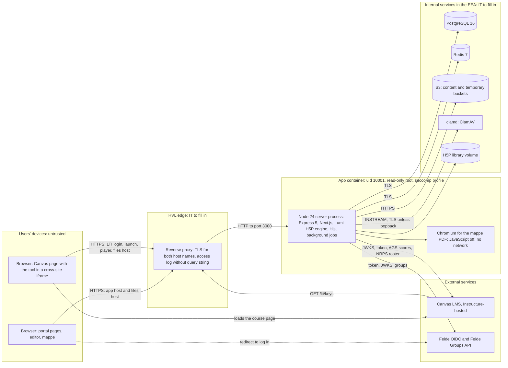

# Architecture, trust boundaries and data flows

| | |
|---|---|
| **Status** | **Draft for HVL IT to correct.** Not approved by anyone. |
| **Written by** | An AI agent (Claude), 2026-11-05, by reading the repository at commit `92ca2c5` and running read-only commands. Updated 2026-11-06 at commit `8d4eaf0`, only for `docker.yml`'s runs on GitHub, the image size and the `PROGRESS.md` line references (§3, §8, §11); no file under `apps/server/src`, `apps/web`, `packages/`, `deploy/` or `content/` changed between those commits (`git diff --stat 92ca2c5 8d4eaf0`). Updated again on 2026-11-06 at commit `43c6673`, after pull requests #18 and #21 were merged: pull request #21's clamd settings probe and build-secret scan (§1, §3, TB9, N9, §10, §11), `docker.yml` on `main` (§8) and line references into the files it changed. |
| **Reviewed by** | No person yet. The code, its tests and its earlier reviews were all written by the same AI. No person has reviewed the code or this document ([human-review.md](human-review.md)). A second AI agent checked this document's claims against the repository on 2026-11-05 and corrected some; that is not a human review. |
| **For** | HVL IT operations and security staff who decide whether and how to host HVL Interaktiv. |
| **Part of** | The IT assurance pack: start at [README.md](README.md). See also [threat-model.md](threat-model.md), [ros-analyse.md](ros-analyse.md), [test-environment.md](test-environment.md) and the SBOM [sbom.cdx.json](sbom.cdx.json). |

**How to read the evidence.** Every row names where its claim comes from: a file (with lines where useful), a
decision (`D-nnn` in [docs/DECISIONS.md](../DECISIONS.md)), a requirement ID (in `docs/specs/`) or a test file.
Paths that start with `src/` are under `apps/server/src/`. "**(IT to fill in)**" marks an HVL fact the repository
cannot know. Where this document and the code disagree, the code is right and this document needs fixing.

**The stages** used below (the same in the whole pack):

- **Stage 0:** students run the app on their own machines or in Codespaces, against the built-in mock Feide and mock
  Canvas. No HVL system is involved and IT is not needed (`.devcontainer/README.md:3-6`,
  `tools/mock-platform/README.md`).
- **Stage 1:** one isolated test server, made-up data only, Feide test users and HVL's test Canvas, for a limited
  time. This is what we ask IT for now ([test-environment.md](test-environment.md)).
- **Stage 2:** a pilot with real students in one or two courses, only after DPO approval, a human security review, a
  ROS-analyse and an operations agreement.

## 1. The system in one paragraph

HVL Interaktiv is **one Node.js 24 process** in one container image. It serves the web app (Next.js, run inside the
same process, D-068), the H5P player and editor (Lumi's `h5p-server` behind our own Express 5 routes), the LTI 1.3
tool for Canvas (ltijs 7), the Feide login, a JSON API and background jobs (grade sending, clean-ups and the yearly
purge, each run on one node at a time through a Redis lease). It listens on one port (`PORT`, default 3000) and
answers **two host names**: the app origin (`PUBLIC_BASE_URL`) and a separate files origin for uploaded files
(`FILES_BASE_URL`, default `files.<host>`). It stores data in PostgreSQL 16, Redis 7 and S3-compatible object storage,
sends every upload to a ClamAV daemon (clamd) when one is configured (production requires one unless it is
explicitly turned off) and refuses uploads until clamd has proven its alert settings, and prints the pedagogisk mappe as PDF with a sandboxed Chromium inside the same container.
TLS is terminated by a reverse proxy in front of it (`src/config/env.ts:77`, `deploy/Dockerfile:111,131-134`,
`src/server/createApp.ts:158-198`, `src/config/malwareScanConfig.ts:11-12`,
`src/security/malware/ClamdSettingsProbe.ts`, `docs/ops/runbook.md:14-31`).

## 2. Component diagram

The diagram shows a stage-1 or production-like install. In stage 0 the mocks on the same machine replace Canvas and
Feide. Each box labelled "IT to fill in" is HVL's choice.

## 3. Components and versions

Runtime dependencies are pinned to exact versions, and `npm run check:pins` checks this (CLAUDE.md §1,
`tools/dependency-check/checkPins.mjs`). The SBOM ([sbom.cdx.json](sbom.cdx.json)) lists the npm production packages
(477, our five workspaces among them), H5P core and editor, the ten root content types and three container images
(the `ubuntu` and `node` base images, and the local stack's `clamav`). It does **not** list the Ubuntu packages or
the Chromium build in the image, nor the other 110 H5P libraries in the manifest (`tools/sbom/README.md`, «What the
file does not list»).

| Component | Version or pin | What it does here | Evidence |
|---|---|---|---|
| Base image | `ubuntu:24.04` by digest `sha256:fe81560990fa…` | Every image stage | `deploy/Dockerfile:22`; D-110 (P3 amendment) |
| Node.js | 24; the image copies it from `node:24-bookworm-slim` by digest `sha256:c86ecead9e55…` (v24.22.2) | Runtime; engines `>=24.0.0 <25` | `deploy/Dockerfile:20,23-27`; `package.json` `engines`; `docs/DECISIONS.md:3641-3645` |
| tsx | 4.23.15 | Runs the server's TypeScript directly; there is no compile step | `deploy/Dockerfile:134`; `apps/server/package.json` |
| Express | 5.3.0 | HTTP routing; `X-Powered-By` off | `apps/server/package.json`; `src/server/createApp.ts:159` |
| Next.js, React | `next` 16.4.2, `react`/`react-dom` 19.3.1 | Web app, in the server process (`WEB_APP=prod`); image optimiser off | `apps/web/package.json`; `apps/web/next.config.mjs:23-24`; D-068 |
| Lumi H5P engine | `@lumieducation/h5p-server` 10.0.4, plus `h5p-clamav-scanner`, `h5p-svg-sanitizer`, `h5p-redis-lock` 10.0.4. **CVE-2025-7062 is unpatched in 10.0.4** | H5P player, editor and storage | `apps/server/package.json`; CLAUDE.md §1; D-003; D-112 |
| H5P core (client files) | Tag `1.28.0`, commit `2aeb0b83fa60…`, every file hash-checked | Player JavaScript and CSS | `tools/h5p-core/fetchCoreClients.sh:23-26`; D-027 |
| H5P editor (client files) | Commit `ab2daa18bd61…` (there is no 1.28 release), every file hash-checked | Editor JavaScript and CSS | `tools/h5p-core/fetchCoreClients.sh:28-30`; D-022 |
| Ten content types | Pinned commits; see section 10 | The authorable activity types | `tools/h5p-libraries/libraries.manifest.json`; D-078 |
| H5P core API version | `{ major: 1, minor: 28 }`; Hub endpoints on `hub-api.h5p.org`; usage statistics and Content Hub off | Engine configuration | `src/h5p/H5pConfigFactory.ts:24-30,109-111` |
| ltijs | 7.0.7. Its `mongoose`, `mongodb` and `ioredis` are installed and loaded but never connected | LTI 1.3 launch, Deep Linking, NRPS | `apps/server/package.json`; `src/lti/LtiProviderFactory.ts:1-15`; D-050 |
| openid-client | 6.8.8 | Feide OIDC client | `apps/server/package.json`; `src/auth/feide/FeideClient.ts` |
| Prisma, pg | `@prisma/client`, `@prisma/adapter-pg`, `prisma` 7.10.1; `pg` 8.23.1 | Database access and migrations | `apps/server/package.json`; `package-lock.json` |
| Other server packages | `redis` 4.7.1, `@aws-sdk/client-s3` 3.1155.0, `clamscan` 2.4.0, `pino` 10.4.0, `zod` 4.6.7, `jsdom` 26.1.0, `dompurify` 3.4.17 | Redis, S3, clamd client, logs, validation, SVG sanitising | `apps/server/package.json` |
| playwright-core and Chromium | `playwright-core` 1.56.1; full Chromium build `chromium-1194` (141.0.7390.37), never the headless shell | Renders the mappe PDF (`MAPPE-004`) | `deploy/Dockerfile:66-71,112`; `PROGRESS.md:1489`; D-096 |
| tini, fonts, Chromium's system libraries | From Ubuntu's archive at build time, **versions not pinned** | PID 1; æ, ø and å in the PDF | `deploy/Dockerfile:103-108,133` |
| Seccomp profile | Playwright v1.56.1's profile, byte for byte, SHA-256 `cc3e61cabda6…` | Lets Chromium keep its sandbox as non-root | `deploy/seccomp/README.md`; `tools/deploy-check/deployRules.mjs` |
| Browser-side scripts | H5P core and content-type JavaScript, and our theme scripts including the xAPI bridge | Run in users' browsers, served from the app origin | `packages/hvl-h5p-theme/`; D-102; `src/http/h5pPageCsp.ts:83` |
| PostgreSQL | 16. Local stack pins `postgres:16-alpine` by digest; root compose and CI use the tag only. **HVL's server: (IT to fill in)** | Relational data | `deploy/compose.app.yml:65`; `docker-compose.yml:14`; `.github/workflows/ci.yml:35` |
| Redis | 7. Local stack by digest; root compose and CI by tag. Must run with `maxmemory-policy noeviction`. **HVL's server: (IT to fill in)** | Sessions, caches, locks, leases, rate limits | `deploy/compose.app.yml:77`; `docker-compose.yml:27`; `.github/workflows/ci.yml:44`; `apps/server/.env.example:32-35` |
| Object storage | Any S3-compatible store in the EEA. Local and CI use the moto emulator 5.1.16. **Which store: (IT to fill in)** | Content files and temporary uploads | `src/config/storageResidency.ts:30-40`; `deploy/compose.app.yml:84`; D-023 |
| ClamAV (clamd) | Local stack and CI: `clamav/clamav:1.4` by digest (ClamAV 1.4.6); CI runs it twice, once without the alert settings, to show that uploads are then refused. **HVL's clamd: (IT to fill in)** | Scans every upload before it is stored (`SEC-006`), once its alert settings are proven | `deploy/compose.app.yml:91-106`; `.github/workflows/ci.yml:54,66`; `docs/ops/clamav.md` |
| Reverse proxy | **(IT to fill in)** | TLS, compression, request ID, access log | `docs/ops/runbook.md:26,296-299` |

## 4. Trust boundaries

| # | Boundary | What crosses it | What the app relies on or enforces | Evidence |
|---|---|---|---|---|
| TB1 | **Browser to app origin** | Every page, API and H5P request from users | Everything from the browser is untrusted. The portal session is a `__Host-` cookie (`Secure; HttpOnly; SameSite=Lax`) with a synchronizer CSRF token on unsafe methods. LTI requests carry the ltik as `Authorization: Bearer`. H5P pages have a CSP with `script-src 'self'` plus hashes, never `unsafe-inline` or `unsafe-eval`. Every response gets `nosniff`, `Referrer-Policy: no-referrer` and HSTS over https | `src/auth/session/sessionCookies.ts:25-33`; `src/auth/session/csrfToken.ts`; `src/auth/requestPrincipal.ts`; `src/http/h5pPageCsp.ts:12-13,83`; `src/http/securityHeaders.ts:25-34`; `AUTH-003` |
| TB2 | **Canvas frame (cross-site)** | Canvas shows the tool in an iframe of another site; the browser posts the launch to `/lti/login` and `/lti/launch` | ltijs checks the launch token's signature against Canvas's JWKS, its audience and its nonce (used once). We check the deployment ID and the platform's active flag, which ltijs does not. The portal cookie is `SameSite=Lax`, so it is not sent in the frame: the ltik is kept in page memory and sent as a bearer token; a query ltik is accepted only on the five paths in `LTIK_QUERY_PATHS` and on `/app/play`, where the LTI router checks it before the web app sees it. LTI pages may be framed only by `CANVAS_ORIGINS`; `/lti/play` and `/lti/edit` may also be framed by the app's own `/app/play` page. An LTI launch never grants `admin` | `src/lti/LtiProviderFactory.ts:29-33`; `src/lti/platforms/LtiDeploymentGuard.ts`; `src/auth/requestPrincipal.ts:31-38`; `src/lti/play/appLaunchRoutes.ts:1-10`; `src/lti/http/ltiPageHeaders.ts:1-17`; `src/lti/LtiRoleMapper.ts:9`; D-050, D-051, D-058; `apps/server/e2e/ltiIframe.e2e.test.ts` (a launch with third-party cookies blocked) |
| TB3 | **Feide** | The browser is redirected to Feide to log in; the server exchanges the code and reads the user's groups | Authorization Code with PKCE `S256`, `state` and `nonce`; the ID token's `iss`, `aud`, `nonce`, `exp` and signature (Feide's JWKS) are checked; the client secret is sent by POST and never logged. Login fails if the Groups API fails | `src/auth/feide/FeideClient.ts:1-16,70-84,102-106`; `src/auth/feide/feideGroups.ts:37`; `AUTH-001`; D-054 |
| TB4 | **App host and files host** | Uploaded files that authors put into activities | One process, told apart by `Host`. A files-host request meets a files-only router before any session, LTI, API or web code; that router reads no cookie, ltik or `Authorization` header and sets no cookie. It serves a file only for `GET`/`HEAD` with a signed grant, answers CORS preflights (`OPTIONS`) on that path, and answers 404 to everything else; every answer gets `CSP: sandbox; default-src 'none'; …` and `nosniff`. **Limits:** `files.<host>` is the same *site* as the app (a separate registrable domain would isolate more, HVL's choice, Q5); the **editor's** files are still served from the app origin (`SPEC-DEVIATION: D-110`) | `src/http/filesOriginRouter.ts:1-25`; `src/config/filesOrigin.ts:1-20`; `src/security/ContentFileHeaders.ts:76`; `src/h5p/createH5pRuntime.ts:15-16`; `src/http/routes/fileRoutes.ts:11`; `SEC-004`; D-012, D-045, D-110 |
| TB5 | **Reverse proxy to app** | All inbound traffic, in plain HTTP behind the proxy | The app trusts `X-Forwarded-*` only from `TRUST_PROXY` proxies (0–5, usually 1). The proxy must terminate TLS for both names, set `X-Forwarded-Host` itself, pass `Host` on, and **leave the query string out of its access log**, because a few routes accept `?ltik=` | `src/server/createApp.ts:160-161`; `apps/server/.env.example:108-112`; `docs/ops/runbook.md:296-305`; DPIA input R26 |
| TB6 | **App to internal services** | SQL, Redis commands, S3 objects, uploads to clamd | In production the server refuses to start unless PostgreSQL uses `sslmode` `require`/`verify-ca`/`verify-full`, Redis uses `rediss://`, S3 uses https in an EEA region or on an allowed domain, and clamd is reached over TLS (unless on the loopback). The database has three roles; the app's role cannot change the schema or rewrite audit rows | `src/config/connectionEncryption.ts:8-11,49-58`; `src/config/storageResidency.ts:1-40`; `src/config/malwareScanConfig.ts:1-17`; `docs/ops/database-roles.md`; `DATA-004`, `DATA-010`; D-109 |
| TB7 | **App to Canvas services (outbound)** | Client-credentials token requests, scores (AGS), roster reads (NRPS) | AGS tokens are requested with a JWT signed by the tool's own key. Our AGS client never follows a redirect; NRPS roster reads go through ltijs's own HTTP client, whose redirect handling this document has not checked. A line item or roster URL must be on an origin in `CANVAS_ORIGINS` or the platform's own, over https in production, checked when the launch records it and again before each send | `src/grades/AgsAccessTokens.ts:1-20,148-149`; `src/grades/AgsScoreClient.ts:18,128-131`; `src/grades/lineItemUrlPolicy.ts:1-15`; `src/server/main.ts:101-110`; D-104 |
| TB8 | **App to Chromium (inside the container)** | HTML of the mappe for printing | Each export runs in a fresh context with JavaScript off, `offline: true`, and every request aborted. Chromium keeps its own sandbox through the seccomp profile and `CAP_SYS_CHROOT` | `src/learningDesign/mappe/pdf/PdfRenderer.ts:106,119-120`; `docs/ops/docker.md:29-35`; D-096 |
| TB9 | **Third-party H5P code to learners' browsers** | Content-type JavaScript from H5P's GitHub repositories, served from the app origin | Libraries change only through the seed step (from the pinned, hash-checked bundle) or an `admin`'s package import, which the code allows (D-041); both first scan the library files for a build machine's secrets, as the bundle tool does (D-110's amendment of 2026-11-06); only `admin` may install or update libraries; any other author's package may carry only libraries already installed in the same version; the Hub is never used at runtime; every library change writes an audit row | Section 10; `src/h5p/libraries/packageLibraryCheck.ts`; `src/h5p/libraries/libraryBuildSecrets.ts`; `src/h5p/HvlH5PEditor.ts:73,192-193`; D-004, D-041; `SEC-003`, `H5P-011` |

## 5. Network flows

**Direction** is seen from the app server. **Stage 1?** says whether the flow is needed on the stage-1 test server.
Stage 1 assumes the image runs as staging does in `docs/ops/docker.md:99-105`: `NODE_ENV=production`, so the TLS, EEA
and scanner start checks apply. Ports for HVL's services are **(IT to fill in)**; the values shown are the defaults.

| # | Direction | From | To | Protocol and port | Purpose | Stage 1? | Evidence |
|---|---|---|---|---|---|---|---|
| N1 | In | Users' browsers | Proxy, then app: app host (`PUBLIC_BASE_URL`) | HTTPS 443 at the proxy; HTTP to the app on `PORT` (3000) | Pages, API, H5P player and editor, LTI pages | Yes | `src/config/env.ts:77`; `deploy/Dockerfile:131`; `docs/ops/runbook.md:25-26` |
| N2 | In | Users' browsers | Proxy, then app: files host (`FILES_BASE_URL`) | HTTPS 443, same app port | The player's uploaded files, with a signed grant | Yes | `src/http/filesOriginRouter.ts`; `apps/server/.env.example:96-102` |
| N3 | In | Browser in the Canvas frame, sent by Canvas | `/lti/login`, `/lti/launch` | HTTPS 443 (form posts) | LTI 1.3 login and launch | Yes (HVL's test Canvas) | `src/lti/LtiProviderFactory.ts:29-33`; `docs/reference/canvas-lti13-developer-key.json:4-5` |
| N4 | In | Canvas servers | `/lti/keys` | HTTPS 443 | Canvas reads the tool's public keys (the developer key's `public_jwk_url`) | Yes | `docs/reference/canvas-lti13-developer-key.json:6`; `src/lti/LtiProviderFactory.ts:32` |
| N5 | In | HVL monitoring | `GET /healthz` | HTTP or HTTPS | Health check: 200 or 503 with the failing service; no login | Yes | `src/server/healthRoutes.ts:1-17`; `docs/ops/runbook.md:202-204` |
| N6 | Out | App | PostgreSQL | TCP, port in `DATABASE_URL` (5432 locally); TLS required in production | All relational data | Yes | `src/config/connectionEncryption.ts:8-11`; `apps/server/.env.example:25-30` |
| N7 | Out | App | Redis | TCP, port in `REDIS_URL` (6379 locally); `rediss://` required in production | Sessions, caches, locks, leases | Yes | `src/config/connectionEncryption.ts:54-55`; `apps/server/.env.example:32-37` |
| N8 | Out | App | S3-compatible store (`S3_ENDPOINT`, or AWS S3 in `S3_REGION`) | HTTPS 443; EEA allow-list; the SDK's own endpoint variables refused | Content files and temporary uploads | Yes | `src/config/storageResidency.ts:1-47`; `apps/server/.env.example:39-66` |
| N9 | Out | App | clamd, or a TLS proxy in front of it | TCP `CLAMAV_PORT` (3310); TLS unless loopback; the proxy must not rely on SNI | Scan each upload (`INSTREAM`); fails closed. Before the first scan, then at most once a minute, three probe streams prove `AlertEncrypted` and `AlertExceedsMax`; `npm run clamd:check` runs the same probe at deployment | Yes. Production refuses to start without it unless `CLAMAV_ALLOW_UNSCANNED_UPLOADS=true` | `src/config/malwareScanConfig.ts:1-17`; `src/security/malware/ClamdSettingsProbe.ts`; `docs/ops/clamav.md:62-74` and «The settings probe»; `apps/server/.env.example:257-284` |
| N10 | Out | App | Feide OIDC, `FEIDE_ISSUER` (default `https://auth.dataporten.no`) | HTTPS 443 | Discovery, token exchange, ID-token keys (JWKS) | Yes (Feide test users) | `src/auth/feide/FeideClient.ts:70-84`; `src/config/env.ts:87`; `docs/reference/feide-values.md:60-67` |
| N11 | Out | App | Feide Groups API, `FEIDE_GROUPS_API_URL` (default `https://groups-api.dataporten.no`) | HTTPS 443 | `GET /groups/me/groups` with the user's token, for roles | Yes | `src/auth/feide/feideGroups.ts:37`; `src/config/env.ts:90` |
| N12 | Browser | Users' browsers | Feide | HTTPS 443 | Login and logout pages (the app allows Feide as a form target) | Yes | `src/server/createApp.ts:191`; `src/auth/feide/feideLoginRoutes.ts` |
| N13 | Out | App (ltijs) | Canvas platform JWKS (`LTI_PLATFORMS[].jwksUrl`) | HTTPS 443 | Check launch-token signatures; cached 5 minutes in Redis | Yes | `src/lti/platforms/syncLtiPlatforms.ts:38`; `docs/reference/canvas-platform-values.md:30`; `docs/privacy/DATA-INVENTORY.md` (Redis keys) |
| N14 | Out | App | Canvas token endpoint (`LTI_PLATFORMS[].tokenEndpoint`) | HTTPS 443 | Client-credentials tokens for AGS (our client, which follows no redirect) and NRPS (ltijs's client) | Yes, to test grades and insight counts | `src/grades/AgsAccessTokens.ts:1-20`; `docs/reference/canvas-platform-values.md:31` |
| N15 | Out | App (grade worker, every 15 s) | Canvas AGS line items on the institution's Canvas domain | HTTPS 443 | Send formative scores; retried for 24 h | Yes, if graded placements are tested | `src/grades/AgsScoreClient.ts`; `src/grades/GradeSyncWorker.ts:28`; `docs/ops/runbook.md:223-224` |
| N16 | Out | App | Canvas NRPS roster URL from the launch | HTTPS 443 | Count a course's active learners (pages of 50, 60 s limit); only the count is stored | Yes | `src/lti/nrps/nrpsRosterRead.ts:1-30`; `apps/server/.env.example:166-170` |
| N17 | Browser | Author's browser | Canvas's Deep Linking return URL | HTTPS 443 (form post) | Hand the chosen activity back to Canvas | Yes | D-061 |
| N18 | Browser | Learners' browsers | HVL's Panopto site and `developers.panopto.com` (one file) | HTTPS 443 | Outside video, **only** when a Panopto site is in `EXTERNAL_MEDIA_ORIGINS`. YouTube must never be listed (owner decision, D-070); the code does not refuse it, so this is a configuration rule | No (off by default) | `src/http/h5pPageCsp.ts:40-45`; `apps/server/.env.example:121-128`; D-070 |
| N19 | Out (HVL's clamd) | clamd's `freshclam` | `database.clamav.net` or HVL's mirror | HTTPS (to confirm; the repository does not say) | Daily signature updates; HVL's, not the app's | Yes, where clamd runs | `docs/ops/clamav.md:169-172` |

**Never contacted while serving** (from reading the code):

- **The H5P Hub.** The editor's content-type list is stored as empty, its Hub calls are replaced, and Hub installs
  answer 403. Only the manual `npm run hub:check` contacts `hub-api.h5p.org`; `api.h5p.org` is never used
  (`src/h5p/offlineContentTypeCache.ts:1-18`; `src/h5p/HvlH5PEditor.ts:73,192-193`; D-041).
- **Vendor telemetry.** Off for Next.js and Prisma (`NEXT_TELEMETRY_DISABLED=1`, `CHECKPOINT_DISABLE=1`;
  `deploy/Dockerfile:28-30`; `src/web/nextWebApp.ts:56`). H5P usage statistics are off
  (`src/h5p/H5pConfigFactory.ts:109-111`).
- **MongoDB.** ltijs's database drivers are loaded but never connected (D-050).
- **Anything from Chromium.** The PDF renderer runs offline with every request aborted (TB8).
- **GitHub.** Not at runtime, and not during the image build either (below).

**How this was proven, and its limit.** Browser-side "first-party only" is tested: a Playwright suite records every
request of every web view, of the Canvas player for each of the ten types and of each editor, and asserts that only
the app and files origins are requested (`apps/server/a11y/firstParty.a11y.test.ts`; `DATA-011`). **Server-side
egress has no such test.** Rows N6–N16 come from reading the code; IT can confirm them with an egress allow-list on
the stage-1 server.

**Stage 0** needs none of N1–N19 against HVL: the mock Canvas runs on `127.0.0.1:4100` and the mock Feide on
`localhost:4200` (`apps/server/.env.example:119,152,174,186`).

**Egress when building, not on the server.** The image build fetches only from `archive.ubuntu.com`,
`security.ubuntu.com`, `registry.npmjs.org` and `binaries.prisma.sh`, and in CI Playwright's download host for
Chromium. It never fetches GitHub content: H5P core, editor and the content-type bundle come in as hash-checked build
contexts (`docs/DECISIONS.md:3658-3666`; `deploy/Dockerfile:84-101`). The fetch tools that prepare those contexts need
`github.com`, and the 23 library builds' `npm ci` needs `registry.npmjs.org` (`tools/h5p-libraries/README.md`;
`docs/ops/docker.md:66-67`). Where HVL builds the image and which registry
the server pulls it from: **(IT to fill in)**.

## 6. Data stores

Full field lists are in [docs/privacy/DATA-INVENTORY.md](../privacy/DATA-INVENTORY.md), which CI checks against the
database schema (`DATA-001`).

| Store | What it holds | Personal data? | Retention | In the backup? | Evidence |
|---|---|---|---|---|---|
| **PostgreSQL 16** | Activities and their settings; staff accounts (display name, keyed hash of the Feide ID); learner data under the pseudonym `learnerKey` (xAPI statements, saved progress, grade jobs); LTI records; audit tables; *k*-suppressed insight snapshots | **Yes.** Staff personal data; pseudonymous learner data; launch ID-token claims (an allowlist that **includes the raw Canvas `sub` in clear**) for 24 h; beyond 24 h the raw `sub` is kept only **encrypted**, in grade jobs; LTI tool private keys encrypted | Learner rows: yearly purge, default 31 August. Encrypted `sub`: 30 days after the job stops. LTI ID tokens 24 h, nonces 10 min. Audit: 2 years required, **deletion not built** (DPIA input R27). Staff accounts: until deleted by hand (DPIA input R28) | Yes: `pg_dump`, daily, kept 30 days | `docs/privacy/DATA-INVENTORY.md`; `src/grades/GradeSubjectCleanupJob.ts:25-27`; `docs/ops/runbook.md:149-174`; D-052, D-107 |
| **Redis 7** | Portal sessions, login transactions, public-key caches, locks, job leases, rate-limit counters, courses' learner counts | **Yes, by reference:** user IDs and `learnerKey` in sessions; the session's Feide ID token only encrypted. Session keys are a SHA-256 of the cookie value | Sessions: logout, 2 h idle or 12 h total. Counters 1–10 min. Learner counts 30 days | **No.** Losing it logs everyone out | `docs/privacy/DATA-INVENTORY.md:375-414`; `src/auth/session/SessionStore.ts:35-45`; `docs/ops/runbook.md:23` |
| **S3 content bucket** (`S3_CONTENT_BUCKET`) | The media files of activities: images, video, audio, documents | **Can be:** an upload can hold personal data (a photo, a document); the app does not classify it | With the activity | Yes: every object, under its SHA-256 | `docs/privacy/DATA-INVENTORY.md:99-111`; DPIA input R38; `docs/ops/runbook.md:151-155` |
| **S3 temporary bucket** (`S3_TEMPORARY_BUCKET`) | Editor uploads not yet saved | Can be, as above | A 1-day lifecycle rule that **HVL sets** | No | `apps/server/.env.example:64-66`; `docs/ops/runbook.md:24,153` |
| **H5P library volume** (`H5P_LIBRARY_DIR`) | Installed H5P libraries (code), shared by all nodes | No | Until replaced | No: the seed step installs them again from the bundle | `apps/server/.env.example:76-78`; `deploy/compose.app.yml:128-136,145`; `docs/ops/runbook.md:153-155` |
| **Container `/tmp`** (tmpfs, 512 MB in the local stack) | One upload at a time per request, in a fresh folder, while it is sanitised and scanned | Can be | Removed when the request ends | No | `src/http/multipartUpload.ts:12,76`; `deploy/compose.app.yml:58-60` |
| **Logs** (stdout to HVL's log store) | One request line per request (route pattern, status, time, request ID) and event lines | Not by design: redaction by key name, no paths, queries, user IDs or IP addresses. Names typed into free text cannot be detected | 30 days, in HVL's log store **(IT to fill in)** | HVL's choice | `src/logging/logger.ts:1-17`; `src/http/requestLog.ts:1-27`; `docs/privacy/DATA-INVENTORY.md:416-437`; `DATA-009` |
| **Backups** (`npm run ops:backup`) | The database dump, every content object, `MANIFEST.json` and `SHA256SUMS` | **Yes:** everything in PostgreSQL and the content bucket | 30 days; an encrypted copy off the server, in the EEA **(IT to fill in: tool and place)** | — | `docs/ops/runbook.md:149-174`; `tools/ops/README.md`; `NFR-002` |
| **Outside the app** | The proxy's access log; clamd's log; Canvas's gradebook (scores the app sends) | Can be | **(IT to fill in)** | — | DPIA input R26, R38; `src/grades/AgsScoreClient.ts` |

The backup tools are **not in the image** (`tools/` is excluded by `deploy/Dockerfile.dockerignore`); they run from a
repository checkout with Node 24 and PostgreSQL 16's client tools (`docs/ops/runbook.md:31`; `tools/ops/README.md`).
The repository does not set up encryption at rest for the database, Redis or S3: the deployment checklist asks for
the provider's facts on it, and the runbook asks for encrypted backup copies (`docs/ops/database-roles.md:121-123`;
`docs/ops/runbook.md:28,156`). Whether and how HVL encrypts these stores: **(IT to fill in)**.

## 7. Secrets and keys

Names only; no value appears in this pack. Each variable marked `Secret: yes` in `apps/server/.env.example` belongs
in a secret store, never in the image, a compose file or a log (`docs/ops/runbook.md:27`). In production the server
refuses a key that decodes to readable text, has fewer than 16 distinct byte values, or is used in two places; the
runbook asks that every key be made with `openssl rand -base64 32` (`src/config/productionChecks.ts:12-19`;
`docs/ops/runbook.md:121-122`).
The image holds no secret (`docs/ops/docker.md:27`; `deploy/Dockerfile.dockerignore` excludes `.env` files and `.git`).

| Name | Purpose | Where kept | Rotation | Evidence |
|---|---|---|---|---|
| `DATABASE_URL` (holds the `hvli_app` password) | The server's database role | Secret store **(IT to fill in)** | `ALTER ROLE … PASSWORD`, update the store, restart | `apps/server/.env.example:25-30`; `docs/ops/runbook.md:131` |
| Migration URL (`hvli_migrator`) | Migrations and grants, in the migrate step only | CI/CD secret | As above | `apps/server/.env.example:27-28`; `docs/ops/database-roles.md:17` |
| `hvli_analytics` password | The read-only analytics role | **To define** | As above | `docs/ops/database-roles.md:19,41` |
| `REDIS_URL` (holds a password, if any) | Redis | Secret store | Change at Redis and in the store together, restart | `apps/server/.env.example:32-37`; `docs/ops/runbook.md:133` |
| `S3_ACCESS_KEY_ID`, `S3_SECRET_ACCESS_KEY` | The server's storage user | Secret store | New key, restart, revoke the old one | `apps/server/.env.example:47-53`; `docs/ops/runbook.md:132` |
| `FEIDE_CLIENT_SECRET` | Feide client authentication (`FEIDE_CLIENT_ID` is not secret) | Secret store | New secret in Feide's customer portal, restart, revoke the old one | `apps/server/.env.example:176-182`; `docs/ops/runbook.md:130` |
| `PSEUDONYM_SECRETS` | HMAC key for learner pseudonyms, one per academic year | Secret store | Never changed during its year; add next year's before 1 August; **destroy** the ended year's after its purge (a manual step, DPIA input R15) | `apps/server/.env.example:84-89`; `docs/ops/runbook.md:129`; D-107 |
| `IDENTITY_HASH_KEYS` | Keyed hashes of identities and login IP addresses | Secret store | Three steps; remove the old key at least 13 months after step 2 | `apps/server/.env.example:203-211`; D-055 |
| `DATA_ENCRYPTION_KEYS` | AES-256-GCM at rest: LTI tool private keys, LTI access tokens, the session's Feide ID token, grade jobs' Canvas `sub` | Secret store | Three steps; remove the old key at least 31 days after step 2 | `apps/server/.env.example:213-221`; D-056 |
| `URL_SIGNING_KEYS` | Signed file and upload URLs (valid 12–13 h) | Secret store | Three steps; remove the old key at least 13 h 5 min after step 2 | `apps/server/.env.example:223-229`; D-058 |
| LTI tool key pair, one per Canvas platform | Signs Deep Linking responses and AGS client assertions | Made by the server; stored **encrypted in PostgreSQL**; re-encrypted at start-up | Replacing the pair is **not automated: to define**. A suspected leak is an incident | `docs/ops/runbook.md:135-136`; `src/server/main.ts:115-117` |
| TLS certificates for the app and files hosts | HTTPS | Reverse proxy **(IT to fill in)** | **(IT to fill in)** | `docs/ops/runbook.md:25` |
| clamd TLS proxy certificate; a private CA through `NODE_EXTRA_CA_CERTS` | TLS to clamd | **(IT to fill in)** | **(IT to fill in)** | `docs/ops/clamav.md:65-68` |
| Backup encryption key (for example restic's) | The off-server backup copy | **(IT to fill in)** | **(IT to fill in)** | `docs/ops/runbook.md:156-158,173` |
| Local only: `HVLI_DB_PASSWORD`, `HVLI_S3_ACCESS_KEY_ID`, `HVLI_S3_SECRET_ACCESS_KEY` | The local stack; never production | The environment; the smoke test makes random throwaway values | — | `deploy/compose.app.yml:12-13,30-43` |
| Build only: BuildKit secret `proxy_ca` | The development sandbox's proxy CA; never enters a layer; not used in CI | — | — | `deploy/Dockerfile:13-14,42-44` |

## 8. Container hardening

The image itself sets only the user, the file ownership, the PID 1 process and the default environment. The read-only
root file system, `no-new-privileges`, the capabilities, the seccomp profile and the published ports are settings of
the **local** stack's compose file (`deploy/compose.app.yml`). HVL's runtime must set them again, and nothing in the
repository checks that it does **(IT to fill in)**.

| Control | Setting | Evidence |
|---|---|---|
| Non-root user | Runs as uid and gid 10001 (`hvli`), shell `nologin` | `deploy/Dockerfile:109-110,129` |
| Read-only code | The code is owned by root; the app owns only the library volume and `.next/cache` | `deploy/Dockerfile:126-128` |
| Read-only root file system | `read_only: true`, with tmpfs for `/tmp` (512 MB), `/home/hvli` (64 MB) and `.next/cache` (64 MB) | `deploy/compose.app.yml:50-61,146-149` |
| No privilege gain | `no-new-privileges:true` | `deploy/compose.app.yml:55-56` |
| Capabilities | All dropped; `SYS_CHROOT` added back for the app only, because Chromium's sandbox needs it | `deploy/compose.app.yml:54,140-143`; `docs/ops/docker.md:29-35` |
| Seccomp | Playwright v1.56.1's profile, which allows `clone`, `setns` and `unshare` for Chromium's user namespaces. Never `seccomp=unconfined`, `SYS_ADMIN`, root or `--no-sandbox`; production refuses `PDF_ALLOW_NO_SANDBOX=true` | `deploy/compose.app.yml:57`; `deploy/seccomp/README.md`; `src/config/productionChecks.ts:24` |
| PID 1 | `tini` reaps Chromium's child processes; `node` receives `SIGTERM` | `deploy/Dockerfile:132-134` |
| Published ports (local stack) | Only the app, and only on `127.0.0.1` | `deploy/compose.app.yml:11,144` |
| Static checks | `tools/deploy-check` refuses privileged or unconfined services, host namespaces, unpinned images and any added capability but the app's one | `tools/deploy-check/deployRules.mjs:1-17` |
| Start-up signal | The server logs `PDF export availability` with a reason code; without a working sandbox the PDF export answers 503 and the Markdown export still works | `src/learningDesign/mappe/pdf/pdfAvailability.ts:128-129`; `docs/ops/docker.md:43-58` |

**What IT must check** (Q5, `PROGRESS.md:973`):

- **Does HVL's runtime allow a custom seccomp profile and `CAP_SYS_CHROOT`?** OpenShift's `restricted-v2` allows
  neither. If not, the PDF export needs a renderer container of its own (`docs/ops/docker.md:43-46`) **(IT to fill
  in)**.
- **The image is not byte-reproducible.** Ubuntu packages (Chromium's libraries, fonts, `tini`) are not version-pinned,
  and Chromium's version and SHA-256 are printed by the smoke test, not compared with a pinned value
  (`deploy/Dockerfile:103-108`; `deploy/smoke/smokeChecks.sh:133-136`). Two builds show the effect: the same Chromium
  version (141.0.7390.37) printed SHA-256 `dd794b4e…144a` in the development sandbox (`PROGRESS.md:1489`) and
  `85918a99…1a95` on GitHub's runner (logs of jobs 127722905949 and 127736690022).
- **No image is published or signed.** No workflow pushes, signs or attests an image (searched `.github/` and
  `deploy/`). GitHub Actions are pinned by major tag, not by commit SHA (`.github/workflows/ci.yml:94-97`). The image
  workflow `.github/workflows/docker.yml` first ran on GitHub in pull request #18 on 2026-11-06: run 42165369079 was
  cancelled by the next push, and runs 42166052745 (on `3eeea8d`) and 42170423045 (on `8d4eaf0`) passed. They ran the
  smoke checks that had run only in the development sandbox before (`PROGRESS.md:746,1477-1486`), without the
  sandbox's proxy extras (the logs say `sandbox extras: off`): among them EICAR refused by clamd, the files origin's
  headers, and the PDF printed with Chromium's sandbox seen in `/proc`. The workflow is on `main` since pull request
  #18 was merged and passed there (run 42205391749 on `38b1743`, run 42266303382 on `43c6673`); it still builds an
  image only to test it.
- **Size.** The image was 2 777 MB when built in the development sandbox (`PROGRESS.md:1482`) and 1 994 MB when built
  on GitHub's runner (`docker.yml` runs 42166052745 and 42170423045); the repository does not record why they differ. A build needs
  about 8 GB free disk at its peak (`docs/ops/docker.md:138-140`; the sandbox run's disk line, `PROGRESS.md:1489`).
  clamd needs about 1 GB of memory (`docs/ops/clamav.md:203`).
- **Never run the root `docker-compose.yml` on a server**: its PostgreSQL has a fixed development password and its
  Redis has none (`docs/ops/runbook.md:237-241`).

## 9. Logging and monitoring

- **Format.** pino JSON lines on stdout. Every record passes redaction by key name (tokens, cookies, ltik, e-mail,
  names, `sub`, Feide fields and more) (`src/logging/logger.ts:1-17`; `DATA-009`; D-109).
- **Request log.** One line per request: `requestId`, `method`, `route` (the pattern, never the path or query),
  `status`, `durationMs`. An inbound `X-Request-Id` is kept only if it is a UUID or 32 hexadecimal digits
  (`src/http/requestLog.ts:1-27`; `NFR-006`).
- **First log line.** `deployment locations` names the database and Redis hosts and the S3 region and host, to check
  against the deployment checklist (`src/server/main.ts:89-90`; `DATA-004`).
- **Health.** `GET /healthz` answers 200, or 503 with `failing: ["database"]` or `["redis"]`, each checked within 2 s.
  **It does not check S3 or clamd** (`src/server/healthRoutes.ts:1-17`; `src/server/createApp.ts:164`).
- **Alerts the runbook names.** Every `error` line; `retention purge` lines that are not `done`; the start-up warning
  about pseudonym secrets of purged years; API p95 against 300 ms; the 5xx rate (`docs/ops/runbook.md:206-211`).
- **Outside the app.** The proxy's access log must leave out the query string (R26). Keep `DEBUG` without `h5p:*`
  (`docs/ops/clamav.md`). Log store, retention (30 days asked) and monitoring tool: **(IT to fill in)**.
- **Load.** Measured only as a smoke test with 20 learners on one 4-CPU machine with every service on it (page-ready
  p95 1 506 ms, API p95 22 ms, 0 % failures). The 200-learner test that sizes a node has **not been run**; it is HVL's
  to run on a production-like node (`docs/ops/runbook.md:243-278`; `NFR-001`). The app sends about 1.5 MiB per
  empty-cache visit uncompressed, so the proxy must compress (`docs/ops/runbook.md:276-278`).

## 10. H5P content-type supply chain (short)

H5P content types are JavaScript that runs in every learner's browser, so how they arrive matters (TB9).

1. **Core and editor.** `npm run h5p:fetch-core` makes a shallow `git fetch` of one ref, proves the commit hash, and
   compares every file with SHA-256 lists committed in `docs/reference/h5p-core-1.28-seed-packages/` (missing, extra
   or changed files abort). The image build checks the files again (`tools/h5p-core/fetchCoreClients.sh:23-56`;
   `deploy/Dockerfile:95-100`; D-027).
2. **Content types.** `npm run h5p:fetch-libraries` fetches each of 120 libraries at the commit pinned in
   `tools/h5p-libraries/libraries.manifest.json` and proves the commit. 23 of them are built with webpack, using
   `npm ci --ignore-scripts` and the library's own lockfile, in a minimal environment (because `H5P.AudioRecorder`
   1.0 bakes its build's environment into learner JavaScript, DPIA input R39). Only allowed file extensions are copied.
   Three libraries have no matching release tag and are pinned to a commit the AI reviewed (no person has):
   `H5P.Column` 1.22.0, `H5PEditor.InteractiveVideo` 1.26.3, `H5PEditor.Shape` 1.0.0
   (`tools/h5p-libraries/README.md:47-49`; D-078; D-110).
3. **Bundle.** `tools/h5p-bundle` packs the ten `.h5p` packages with a `SHA256SUMS` and refuses a missing, changed or
   unlisted package, any type outside the ten, a text file over 32 MB, and a text file that holds a build machine's
   secret (a secret-like name with a value, a URL with a password, a credential's shape, or a dumped build environment
   with a key the minimal build does not set). The image build verifies the bundle, and the seeder checks each
   package's hash again before it installs (`tools/h5p-bundle/README.md`; `deploy/Dockerfile:101`;
   `src/h5p/libraries/LibraryInstaller.ts:35-43`).
4. **Install.** The `seed` step scans every package for a build machine's secrets, installs from the bundle into the
   library volume, writes one audit row per new or changed library, and then scans the installed library folder,
   failing on a finding; `npm run libraries:check` runs that folder scan alone (runbook §2; D-110's amendment of
   2026-11-06). The runbook's rule is that nobody installs libraries by hand or from the Hub on a running server,
   and that a new version goes through a manifest change whose diff a person reviews, CI, staging and then
   production with the same image digest. Hub installs are refused in code, but an `admin`'s package import can
   still install libraries (with an audit row, after the same scan), so "not by hand" is a procedure, not a technical
   block (`deploy/compose.app.yml:128-136`; `docs/ops/runbook.md:55-70`; `H5P-003`, `H5P-011`; D-041).

The ten roots (CLAUDE.md §1; `tools/h5p-libraries/resolveManifest.mjs:29-41`):

| Type | Version | Commit (first 12) | Type | Version | Commit (first 12) |
|---|---|---|---|---|---|
| H5P.CoursePresentation | 1.28.25 | `369d140c741f` | H5P.DragText | 1.10.52 | `3d3eb6d759b3` |
| H5P.InteractiveVideo | 1.28.37 | `bcfa06d2b057` | H5P.MultiChoice | 1.16.14 | `571f5e002fba` |
| H5P.QuestionSet | 1.21.13 | `4598d1d60ea8` | H5P.Blanks | 1.14.13 | `5fc308e6ea96` |
| H5P.InteractiveBook | 1.15.1 | `90efced9d1fa` | H5P.ImageHotspots | 1.11.6 | `adc855f17f2c` |
| H5P.Column | 1.18.8 | `c8586b59bbc4` | H5P.BranchingScenario | 1.10.1 | `6860e97e9160` |

Other versions of some types appear in the manifest as dependencies of others (for example `H5P.Column` 1.22.0 and
`H5P.ImageHotspots` 1.5.5). `H5P.DragQuestion` (1.14.23 and 1.15.16) is installed as a dependency of the
CoursePresentation, InteractiveVideo and BranchingScenario packages but is never offered as a type to author
(CLAUDE.md §1; D-006; `tools/h5p-libraries/libraries.manifest.json`; `tools/h5p-bundle/README.md:16`).

**Gaps in this chain:** the bundle's `SHA256SUMS` is **not committed**, because the packages are not yet reproducible
across machines; the commit pins are the anchor (`tools/h5p-bundle/README.md:21-23`). The npm dependency trees of the
23 webpack builds are outside our lockfile. The SBOM ([sbom.cdx.json](sbom.cdx.json)) lists H5P core, the editor and
the ten root types by commit, but not the other 110 libraries or those build trees (section 3).

## 11. Open items for IT

HVL facts this document needs **(IT to fill in)**:

- Hosting: HVL's own servers or Sikt (Q5); the container runtime and whether it allows the seccomp profile and
  `CAP_SYS_CHROOT`.
- DNS names and certificates for the app host and the files host; whether the files host should be on a separate
  registrable domain (Q5, D-110).
- Which PostgreSQL, Redis and S3 services, their ports and their EEA locations; confirm the storage allow-list
  (`hvl.no`, `sikt.no`, six AWS regions), which is marked *(verify)* in the code
  (`src/config/storageResidency.ts:30-40`).
- clamd with daily signatures, `AlertExceedsMax yes` and `AlertEncrypted yes` (`npm run clamd:check` must pass), and
  its TLS proxy.
- The reverse proxy, the secret store, the log store, monitoring and the backup target.
- Where the image is built and stored, and whether it should be signed.
- The Feide registration (Q3) and the test Canvas developer key and deployment IDs (Q4, Q13) (`PROGRESS.md:967-971`).
- Who at HVL is the system owner, who owns the test install, and who maintains the service (Q31; D-116).

Known technical gaps from the repository, for the [threat model](threat-model.md) and the
[ROS-analyse](ros-analyse.md): CVE-2025-7062 unpatched upstream (D-003); editor files on the app origin (D-110);
`/healthz` without S3 or clamd; no server-side egress test; unpinned Ubuntu packages and Chromium hash; Actions pinned
by tag; no image signing; the bundle hash list not committed; the build-secret scan is a heuristic; the LTI tool key pair has no rotation procedure; the
container hardening is in the local compose file only; the SBOM leaves out Ubuntu packages, Chromium and 110 H5P
libraries.
