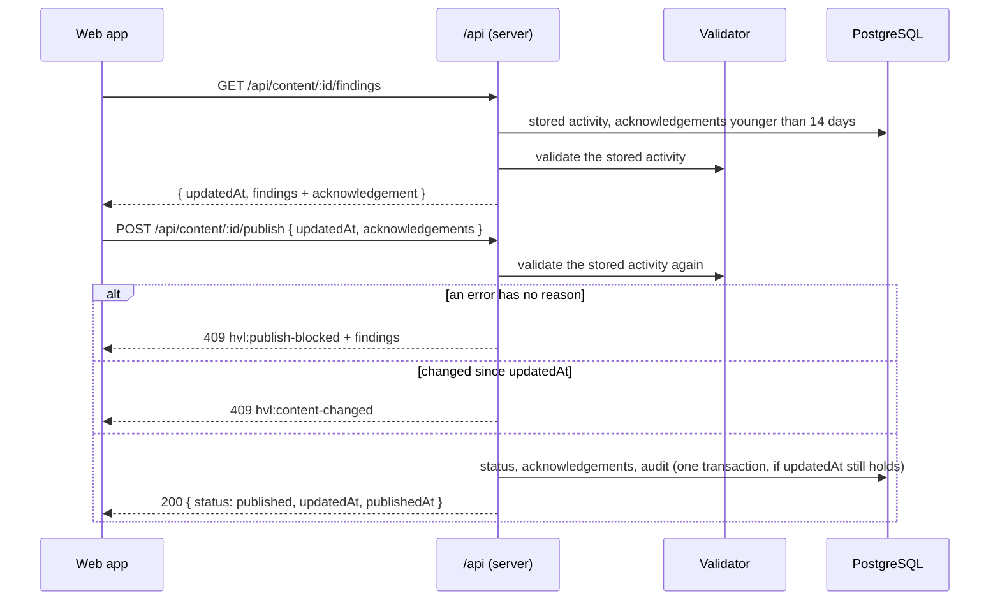

# packages/api-contract

## Purpose

The zod request and response schemas of the `/api` routes, shared by the server (which validates request bodies with
them) and the web app (which types its requests with them), the registry of every `/api` route, and the OpenAPI 3.1
document built from both with zod 4's `z.toJSONSchema` (`DOC-012`, D-077).

## How to run

The package has no build step: both workspaces import `src/index.ts` directly.

```sh
npx vitest run packages/api-contract     # schema and document tests
npm run typecheck --workspace packages/api-contract
```

The server serves the document at `GET /api/docs` when `NODE_ENV` is not `production`.

## Folder structure

| Path | What it holds |
|---|---|
| `src/me.ts` | `GET /api/me` and `PUT /api/me/notices/:noticeId` (`PROD-011`, `DATA-002`) |
| `src/content.ts` | `GET /api/content` and `GET /api/content/:contentId`: summaries and rights |
| `src/findings.ts` | `GET /api/content/:contentId/findings`: findings with their acknowledgements (`UD-022`) |
| `src/publishing.ts` | `POST …/publish` and `POST …/unpublish` (`PROD-003`) |
| `src/sharing.ts` | `PATCH …/sharing` (`PROD-006`, from S3) |
| `src/errors.ts` | The error shape of every `/api` answer, and the publish-blocked answer with findings |
| `src/apiRoutes.ts` | The route registry: method, path, auth mode, request schema, answers by status |
| `src/openApi.ts` | `buildOpenApiDocument()`: the OpenAPI 3.1 document with named components |
| `test/` | Schema tests and document tests |

## Key flows

Publishing an activity from the web app (`PROD-003`, D-074):



Portal requests send the session cookie and, on `PUT`, `POST` and `PATCH`, the `x-csrf-token` header with the
`csrfToken` from `GET /auth/session`. LTI requests send the ltik as `Authorization: Bearer`.

## Configuration

None. The server decides whether to serve `/api/docs` from `NODE_ENV` (see `apps/server/.env.example`).

## Implements

`DOC-012` (schemas and document), and the shapes of `PROD-003`, `UD-022`, `PROD-011`, `PROD-006` and `DATA-002`.
