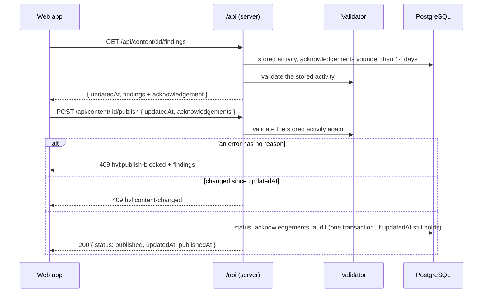

# packages/api-contract

## Purpose

The zod request and response schemas of the `/api` routes, shared by the server (which validates request bodies with
them) and the web app (which types its requests with them), the registry of every `/api` route, and the OpenAPI 3.1
document built from both with zod 4's `z.toJSONSchema` (`DOC-012`, D-077). Since S5 the registry is split by area,
a route may answer a file (`mediaType`) and take query parameters (D-099), and the S5 error codes live here too. S6
adds the xAPI batch the player's bridge posts, the grade-sync status and retry, and the parts every insight answer
shares (D-104, D-106, D-115).

## How to run

The package has no build step: both workspaces import `src/index.ts` directly.

```sh
npx vitest run packages/api-contract     # schema and document tests
npm run typecheck --workspace packages/api-contract
```

The server serves the document at `GET /api/docs` when `NODE_ENV` is not `production`.

## Folder structure

| Path | What it holds |
|---|---|
| `src/me.ts` | `GET /api/me` and `PUT /api/me/notices/:noticeId` (`PROD-011`, `DATA-002`) |
| `src/content.ts` | `GET /api/content` and `GET /api/content/:contentId`: summaries (with the learner info) and rights |
| `src/findings.ts` | `GET /api/content/:contentId/findings`: findings with their acknowledgements (`UD-022`) |
| `src/publishing.ts` | `POST …/publish` and `POST …/unpublish` (`PROD-003`) |
| `src/sharing.ts` | `PATCH …/sharing` (`PROD-006`, from S3) |
| `src/errors.ts` | The error shape of every `/api` answer, and the publish-blocked answer with findings |
| `src/studio.ts` | Phases, pattern cards and pages, references, the studio overview and the guide (`PED-001`–`PED-011`) |
| `src/guideNodes.ts` | The guide's closed node tree and its safe link targets (`PED-002`, D-083) |
| `src/patterns.ts` | Creating an activity from a pattern (`PROD-001`, D-085) |
| `src/learnerInfo.ts` | What learners see before they start: minutes and purpose (`PED-032`); a leaf module |
| `src/learningDesign.ts` | Learning-design metadata, course codes and outcomes (`PED-030`, D-087) |
| `src/planner.ts` | The alignment planner (`PED-031`, D-088) |
| `src/collaboration.ts` | People search, co-authors, the content bank and duplicating (`PROD-007`, D-090–D-092) |
| `src/sourceAttribution.ts` | Where a copy came from, in the activity detail (D-092); a leaf module |
| `src/mappe.ts` | The pedagogisk mappe picker, criteria sets, preview and export (`MAPPE-001`, `MAPPE-002`, D-094); `hvl:mappe-not-ready` answers while the content has no mappe files |
| `src/learningDesignErrors.ts` | The S5 error codes and their HTTP statuses, shared by the server and the web app |
| `src/xapi.ts` | `POST /api/h5p/xapi`: the batch envelope (one activity and version, 1–50 items), each item cut down to the fields the server reads with the bridge's `statementId` and `attemptId`, the score checks and the batch limits (`LTI-011`, D-115) |
| `src/xapiResponseCaps.ts` | Which answers are stored, each gap cut to 100 characters and an answer over 1 000 dropped (`DATA-012`, `INS-003`, D-115) |
| `src/gradeSync.ts` | `GET …/grade-sync` and `POST …/grade-sync/retry`: job counts per placement, not *k*-suppressed (`LTI-012`, D-104) |
| `src/insight.ts` | What every insight answer shares: the fixed periods, the context and version, and a cell that is shown or `{ suppressed: true }` with no value (`INS-006`, D-106) |
| `src/routes/routeResponses.ts` | The answers every area shares (401, 400, 404, 403) and the `:contentId` parameter |
| `src/routes/<area>Routes.ts` | One route registry per area: `core` (before S5), `studio`, `pattern`, `learningDesign`, `collaboration`, `mappe`, `gradeBridge` (S6; joins `API_ROUTES` when step 3 mounts its routes) |
| `src/routes/<area>SchemaNames.ts` | The component names of the schemas each area's routes use |
| `src/routes/collaborationResponses.ts` | The refusals and the co-author path parameter the collaboration routes share |
| `src/apiRoutes.ts` | `API_ROUTES`: the area registries concatenated in document order |
| `src/apiSchemaNames.ts` | `REQUEST_SCHEMAS` and `RESPONSE_SCHEMAS`: the name lists merged, refusing a name used twice |
| `src/apiRouteTypes.ts` | The types of a route, an answer (JSON or file) and a name list; the file media types |
| `src/openApi.ts` | `buildOpenApiDocument()`: the OpenAPI 3.1 document with named components |
| `test/` | Schema tests per area and document tests |

### Adding a route to an area

1. Put the request and answer schemas in your area's schema file (strict objects, `.describe()` texts, an inferred
   type and TSDoc for each export).
2. Name every schema a route uses in `src/routes/<area>SchemaNames.ts` (request bodies under `request`, answers under
   `response`); a name is unique across all areas.
3. Add the route to `src/routes/<area>Routes.ts` with its `params`, `query`, `body` and every answer by status, reusing
   `src/routes/routeResponses.ts`. A file answer sets `mediaType` (`MARKDOWN_MEDIA_TYPE`, `PDF_MEDIA_TYPE`) and no
   schema.
4. Mount it in the server's `/api` router; `apps/server/test/http/api/apiDocs.int.test.ts` fails until the mounted
   routes and the registry agree. That test calls every route signed out with a sample value for each path and query
   parameter (`contentId`, `noticeId`, `userId`, `patternId`, `locale`, `courseCode`, `q`, `format`); a route with
   another parameter name needs a sample there, and a public route must answer 200 to the samples.

## Key flows

Publishing an activity from the web app (`PROD-003`, D-074):



Portal requests send the session cookie and, on `PUT`, `POST`, `PATCH` and `DELETE`, the `x-csrf-token` header with the
`csrfToken` from `GET /auth/session`. LTI requests send the ltik as `Authorization: Bearer`.

## Configuration

None. The server decides whether to serve `/api/docs` from `NODE_ENV` (see `apps/server/.env.example`).

## Implements

`DOC-012` (schemas and document), and the shapes of `PROD-003`, `UD-022`, `PROD-011`, `PROD-006`, `DATA-002`,
`PED-001`, `PED-002`, `PED-010`, `PED-030`, `PED-031`, `PED-032`, `PROD-001`, `PROD-007`, `MAPPE-001`, and from S6
`LTI-011`, `DATA-012`, `LTI-012` and `INS-006` (with the shared parts of `INS-001`–`INS-007`).
