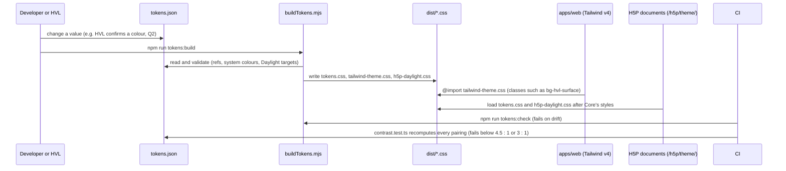

# packages/design-tokens

## Purpose

The single source of colour and typography for HVL Interaktiv (`UD-001`, D-072). `tokens.json` holds HVL's palette
(D-017), the typefaces (D-018), the focus ring (D-007), target size, spacing, the forced-colours overrides and the
mapping onto H5P Core 1.28's Daylight theme. A plain-Node generator writes three committed CSS files from it, and the
contrast test recomputes every foreground/background pairing the product uses on every run. No colour value may be
written anywhere else (Stylelint and ESLint enforce it).

## How to run

```bash
npm run tokens:build          # rewrite dist/ after editing tokens.json
npm run tokens:check          # CI: fails when dist/ differs from what tokens.json gives
npx vitest run packages/design-tokens   # contrast, generator, Tailwind and lint-rule tests
npm run lint:css              # Stylelint over the repository (stylelint.config.mjs)
```

Use the tokens from the web app (Tailwind v4, `apps/web`):

```css
@import 'tailwindcss';
@import '@hvl-interaktiv/design-tokens/tailwind-theme.css'; /* also brings tokens.css */
```

Plain CSS can import `@hvl-interaktiv/design-tokens/tokens.css` alone. Inside H5P, the server serves `tokens.css` and
`h5p-daylight.css` under `/h5p/theme/` (`apps/server/src/h5p/h5pAssets.ts`).

## Folder structure

| Path | What it holds |
|---|---|
| `tokens.json` | Every token, the forced-colours overrides, the Daylight mapping and the declared pairings with their measured ratios |
| `scripts/buildTokens.mjs` | The command line: build, or `--check` for drift |
| `scripts/tokenModel.mjs` | Reads and validates tokens.json; flattens it into `--hvl-*` custom properties |
| `scripts/tokenCss.mjs` | Writes the text of the three generated files |
| `scripts/contrast.mjs` | WCAG 2.x relative luminance and contrast ratio |
| `dist/tokens.css` | Generated: the custom properties on `:root`, with system colours under `forced-colors: active` |
| `dist/tailwind-theme.css` | Generated: Tailwind v4 `@theme` without Tailwind's palette and fonts, `hvl-*` aliases |
| `dist/h5p-daylight.css` | Generated: H5P Daylight's `--h5p-theme-*` variables pointed at the tokens |
| `test/` | Contrast (`UD-001`), generator, Tailwind theme and Stylelint/ESLint rule tests |
| `.gitignore` | Re-includes `dist/` (the root ignores every `dist/`) |

## Key flows



## Configuration

None at run time. Values live in `tokens.json`; see the [server's .env.example](../../apps/server/.env.example)
for the server's settings. The token values are HVL's 2017 Profilmanual as transcribed in
[docs/reference/hvl-visual-identity.md](../../docs/reference/hvl-visual-identity.md); HVL must still confirm them (Q2).

### Tokens

Colour classes exist for every colour token with any Tailwind colour utility (`bg-`, `text-`, `border-`, `outline-`,
`ring-`, `fill-`, `stroke-`, …), written below as `*-hvl-<name>`. Tailwind's own palette (`bg-red-500`,
`text-white`, …) is removed.

| Custom property | Value | Tailwind | What it is for |
|---|---|---|---|
| `--hvl-primary-dark` | `#004357` (Mørk blå 2) | `*-hvl-primary-dark` | Headings, navigation, primary buttons (white text), links |
| `--hvl-accent` | `#008AAF` (Mørk blå 1) | `*-hvl-accent` | Non-text UI only: progress bars, selected-tab underline, input borders, chart marks. Never body text |
| `--hvl-brand-sea-green` | `#00AFBA` (Sjøgrønn) | `*-hvl-brand-sea-green` | Decoration on light surfaces; non-text accents on primary-dark only |
| `--hvl-brand-orange` | `#EB6851` (Oransje) | `*-hvl-brand-orange` | Decorative fills and badges with ink text. Never a state or focus indicator |
| `--hvl-band` | `#C9D5DA` (Blågrå lys) | `*-hvl-band` | Section bands, table headers, secondary buttons, decorative strokes |
| `--hvl-ink` | `#111111` (neutral) | `*-hvl-ink` | Body text; hover and active fill of primary buttons |
| `--hvl-ink-muted` | `#4A5560` (neutral) | `*-hvl-ink-muted` | Secondary text, text-input borders |
| `--hvl-surface` | `#FFFFFF` (Hvit) | `*-hvl-surface` | Cards, H5P content background, text on dark fills |
| `--hvl-surface-alt` | `#F4F6F7` (neutral) | `*-hvl-surface-alt` | Page background, light panels, hover fills |
| `--hvl-feedback-correct-fg` | `#0F5132` | `*-hvl-feedback-correct-fg` | Correct-answer text |
| `--hvl-feedback-correct-bg` | `#D1E7DD` | `*-hvl-feedback-correct-bg` | Correct-answer background |
| `--hvl-feedback-correct-border` | `#198754` | `*-hvl-feedback-correct-border` | 4 px left border of a correct answer (decorative) |
| `--hvl-feedback-incorrect-fg` | `#6D2439` (Mørk rød) | `*-hvl-feedback-incorrect-fg` | Incorrect-answer text |
| `--hvl-feedback-incorrect-bg` | `#F8D7DA` | `*-hvl-feedback-incorrect-bg` | Incorrect-answer background |
| `--hvl-feedback-incorrect-border` | `#DC3545` | `*-hvl-feedback-incorrect-border` | 4 px left border of an incorrect answer (decorative) |
| `--hvl-feedback-info-fg` | `var(--hvl-primary-dark)` | `*-hvl-feedback-info-fg` | Hint and notice text |
| `--hvl-feedback-info-bg` | `#CFF4FC` | `*-hvl-feedback-info-bg` | Hint and notice background |
| `--hvl-focus-outer` | `var(--hvl-primary-dark)`; `Highlight` in forced colours | `*-hvl-focus-outer` | Outer ring of the two-tone focus indicator |
| `--hvl-focus-inner` | `var(--hvl-surface)`; `Canvas` in forced colours | `*-hvl-focus-inner` | Inner ring of the two-tone focus indicator |
| `--hvl-font-ui` | `Arial, 'Helvetica Neue', Helvetica, sans-serif` | `font-ui`, `font-sans` | Headings, UI controls, captions, H5P content (D-018) |
| `--hvl-font-body` | `Georgia, 'Times New Roman', serif` | `font-body`, `font-serif` | Long-form body text (D-018) |
| `--hvl-font-mono` | `ui-monospace, Menlo, Consolas, monospace` | `font-mono` | Code samples only |
| `--hvl-line-height-body` | `1.5` | `leading-body` | Body text in the web app (`UD-002`) |
| `--hvl-line-height-h5p` | `1.55` | — | Text inside H5P content (`UD-002`) |
| `--hvl-font-size-min` | `1rem` | — | Smallest text size (`UD-002`) |
| `--hvl-measure` | `70ch` | `max-w-measure` | Maximum width of a paragraph (`UD-002`) |
| `--hvl-target-min` | `24px` | `min-h-target`, `min-w-target`, `size-target` | Smallest pointer target (`UD-005`, WCAG 2.5.8) |
| `--hvl-feedback-border-width` | `4px` | — | Left border of a feedback state (`UD-003`) |
| `--hvl-focus-outline-width` | `3px` | — | Width of the outer focus ring (`UD-004`) |
| `--hvl-focus-offset` | `2px` | — | Gap between element and outer ring, filled by the inner ring |
| `--hvl-focus-inner-width` | `2px` | — | Width of the inner focus ring |
| `--hvl-focus-outline` | `var(--hvl-focus-outline-width) solid var(--hvl-focus-outer)` | — | Use as `outline:` on `:focus-visible` |
| `--hvl-focus-shadow` | `0 0 0 var(--hvl-focus-inner-width) var(--hvl-focus-inner)` | — | Use as `box-shadow:` on `:focus-visible` |
| `--hvl-space-xs` … `--hvl-space-xxl` | `0.25rem`, `0.5rem`, `1rem`, `1.5rem`, `2rem`, `3rem` | — | Spacing scale (`xs`, `s`, `m`, `l`, `xl`, `xxl`) |

### Pairings

`tokens.json` `pairings` lists every foreground/background pair the product draws, with its use (`text`,
`large-text`, `non-text`), the measured ratio and where it is drawn. A side is a colour token, or
`{ "mix": [token, percent, token] }` for a shade an H5P library derives from Daylight's variables with
`color-mix(in srgb, …)` (CoursePresentation 1.28's progress bar). `test/contrast.test.ts` recomputes each pair, and
checks that every pair H5P draws over Daylight (its `DAYLIGHT_PAIRS`, including the colours HVL's theme draws instead,
such as the drop-zone border and the answered task dots) is declared here with a use at least as strict.

The focus ring in plain CSS (`UD-004`):

```css
:focus-visible {
  outline: var(--hvl-focus-outline);
  outline-offset: var(--hvl-focus-offset);
  box-shadow: var(--hvl-focus-shadow);
}
```

## Implements

- `UD-001` — tokens are the only source of colour; `test/contrast.test.ts` checks every declared pairing (≥ 4.5 : 1
  text, ≥ 3 : 1 large text and non-text) and the Daylight pairs H5P makes; Stylelint and ESLint refuse colour
  literals elsewhere (`test/styleRules.test.ts`). `SPEC-DEVIATION` D-072: the Tailwind "preset" is
  `dist/tailwind-theme.css`, because Tailwind v4 configures themes in CSS.
- `UD-002` (typefaces, line heights, measure), `UD-004` (focus ring), `UD-005` (target size), `UD-012` (forced
  colours) — the values; `packages/hvl-h5p-theme` and `apps/web` apply them.
- `UD-011` — `dist/h5p-daylight.css`, the Daylight mapping used inside H5P.
