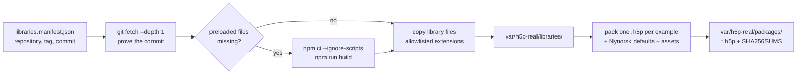

# tools/h5p-libraries

Builds the ten real H5P content types and every library they need from H5P's GitHub repositories, at pinned
commits, and packs one `.h5p` per type with a small Nynorsk example activity (D-078).

## Purpose

The H5P Hub (`hub-api.h5p.org`) is unreachable from the build environment (Q7), so no `.h5p` package published by
H5P can be downloaded. Public GitHub repositories are reachable through `git`. With real content types, Session 4
can test the HVL theme, the feedback prefixes and the accessibility suite on real H5P markup (`UD-003`, `UD-011`,
`UD-030`), and R-01 is settled (D-047). When the Hub becomes reachable, its packages (D-042) replace these for
seeding production; until then these packages serve development, tests and CI.

## How to run

```bash
npm run h5p:fetch-libraries                      # fetch, build and pack into apps/server/var/h5p-real/
npm run seed:libraries -- var/h5p-real/packages  # install them into the server's library storage (dev)
node tools/h5p-libraries/fetchLibraries.mjs --only H5P.Blanks --dest /tmp/x   # pack one example elsewhere
node tools/h5p-libraries/fetchLibraries.mjs --resolve   # re-pin the manifest (review the diff, then commit)
```

The first run clones 120 repositories and builds 23 of them with webpack (a few minutes); later runs reuse the
cache and take seconds. Tests that need the packages (`describeWithRealPackages`) skip locally without them and
fail in CI. `REAL_H5P_PACKAGES_DIR` points tests at another package folder.

## Key flows



- **Pins:** every library is fetched at the commit in `libraries.manifest.json`; a moved tag or another commit
  aborts the run. A few libraries have no matching release tag and are pinned to a reviewed commit
  (`"untagged": true`), as D-022 allows for the editor.
- **What is resolved:** required dependencies (`preloadedDependencies`, `editorDependencies`) and, as optional, the
  sub-content types each library's semantics offers, so containers can save and edit their own children. An
  optional library that cannot be resolved (not in the registry, no matching version, a build without a
  lockfile, or a skipped dependency) is listed under `skipped` with the reason; network errors are retried and
  never cause a skip.
- **Builds:** `npm ci --ignore-scripts` (no third-party install scripts) and the library's own `build` script. The
  checkouts live outside the repository (`H5P_LIBRARIES_CACHE`, default `~/.cache/hvl-interaktiv/h5p-libraries`)
  so a library build never picks up this repository's TypeScript or PostCSS configuration.
- **Files:** only extensions the server accepts in library folders are copied (`libraryFiles.mjs`, checked against
  `apps/server/src/h5p/H5pConfigFactory.ts`); tests, tooling, `node_modules` and documentation stay out.
- **Packages:** `h5p.json`, `content/content.json` (the example, completed with each library's Nynorsk defaults as
  the H5P editor would), the example's assets, and the library closure (preloaded and editor dependencies plus
  every sub-content library). Output is byte-for-byte reproducible.

## Folder structure

| File | Responsibility |
|---|---|
| `fetchLibraries.mjs` | The command: resolve or fetch, build, copy, pack, write `SHA256SUMS` |
| `resolveManifest.mjs` | The ten roots and the recursive, pinned dependency resolution |
| `gitSource.mjs` | `git ls-remote` tags and depth-1 checkouts proven against a commit |
| `libraryFiles.mjs` | Which checkout files belong in a library folder |
| `semanticDefaults.mjs` | Defaults from `semantics.json` and `language/nn.json`, merged under the example |
| `packContentTypes.mjs` | One deterministic `.h5p` per content type |
| `libraries.manifest.json` | The pins (generated by `--resolve`, reviewed, committed) |
| `examples/*.json` | One example activity per content type (Nynorsk; also realistic validator fixtures) |
| `examples/assets/` | Our own image, video and captions used by the examples |

## Configuration

| Variable | Default | Meaning |
|---|---|---|
| `H5P_LIBRARIES_CACHE` | `~/.cache/hvl-interaktiv/h5p-libraries` | Checkouts and builds, outside the repository |
| `REAL_H5P_PACKAGES_DIR` | `apps/server/var/h5p-real/packages` | Where tests look for the packages |
| `--dest <dir>` | `apps/server/var/h5p-real` | Where `libraries/` and `packages/` are written |

## Implements

`H5P-002` (the ten types, never DragQuestion in an example), `H5P-003` (installable packages with `SHA256SUMS` for
the seed command; SPEC-DEVIATION: built from source rather than downloaded from the Hub, D-078), and the S4
verification of `UD-003`, `UD-011` and `UD-030` on real content types.
