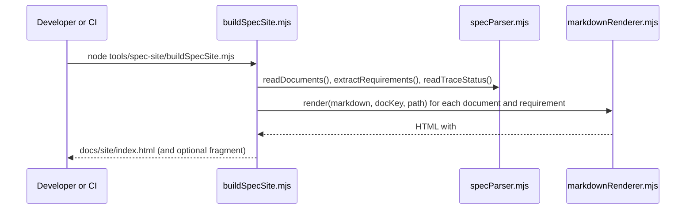

# tools/spec-site

## Purpose

Generates a single-file website of the whole specification: an overview, a filterable list of
all requirements, and every spec and reviewer document. Teachers, ALU staff and evaluators can
read and search the spec without Git. The Markdown files stay the source of truth; this page is
generated from them and never edited by hand.

## How to run it

```bash
node tools/spec-site/buildSpecSite.mjs            # writes docs/site/index.html (open it in a browser)
node tools/spec-site/buildSpecSite.mjs --check    # fails if docs/site/index.html is out of date
node tools/spec-site/buildSpecSite.mjs --fragment /tmp/spec-page.html
                                                  # also writes the page body only, for publishing
                                                  # as a Claude Artifact (the host adds <html>/<head>)
```

You need only Node.js. No `npm install` is required: the Markdown parser is vendored.
Regenerate `docs/TRACEABILITY.md` first (`node tools/spec-trace/specTrace.mjs`), because the
site shows each requirement's status from it.

## Folder structure

| File | Responsibility |
|---|---|
| `buildSpecSite.mjs` | Entry point: reads documents, renders views, writes the output |
| `specParser.mjs` | Reads Markdown files; extracts requirements, sections and tables |
| `markdownRenderer.mjs` | Markdown → HTML with in-page routes, requirement-ID links and heading anchors |
| `overviewView.mjs` | The landing view, assembled from sections of the real documents |
| `pageTemplate.mjs` | Page landmarks, navigation, requirement explorer and document views |
| `spec-site.base.css`, `spec-site.components.css` | Styles (light and dark), following the house rules of spec 03 |
| `spec-site.client.js` | Hash routing, focus management and requirement filtering |
| `vendor/marked.esm.js` | marked 12.0.2 (MIT, see `vendor/marked.LICENSE.md`); SHA-256 `288515814e901ea6535521d9fb35a1329455d3d3973de8723db998536f979cf2` |

## Key flow



## How links work

| In Markdown | On the site |
|---|---|
| `` `SEC-001` `` (a known requirement ID in code formatting) | Link to `#r-SEC-001`, the requirement's heading in its spec |
| `[text](01-h5p-core128.md#3-the-ten-content-types)` | `#spec-01--3-the-ten-content-types` |
| A link to a repository file that the site does not show | A GitHub link on the current branch, marked as external |

## Accessibility

The page applies the spec's own house rules: contrast-checked colour tokens in light and dark
mode, line height ≥ 1.5, left-aligned text, no ALL CAPS, underline only for links, a two-tone focus
ring, and badges that spell out *Must / Should / Could*. Focus moves to the heading of the view you
navigate to. Filter results are announced politely. Without JavaScript, every view is shown in one
long page.

## Implements

`DOC-004` (traceability made visible). It is a reading aid only: the product UI requirements in
spec 03 apply to `apps/web`, not to this tool.
